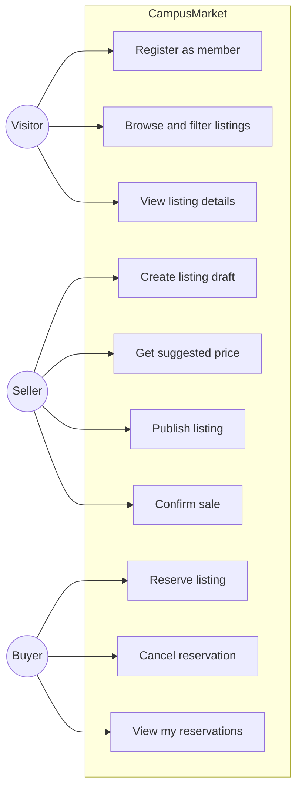
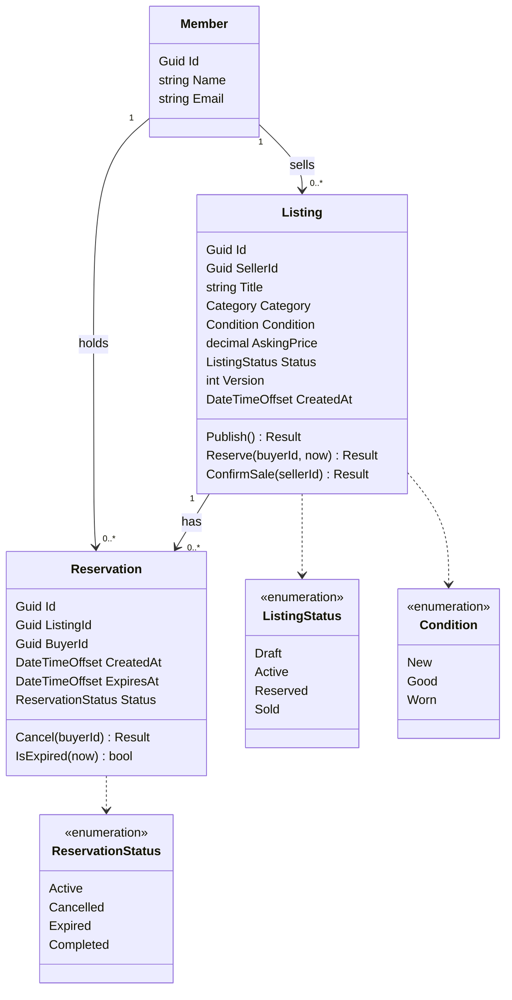
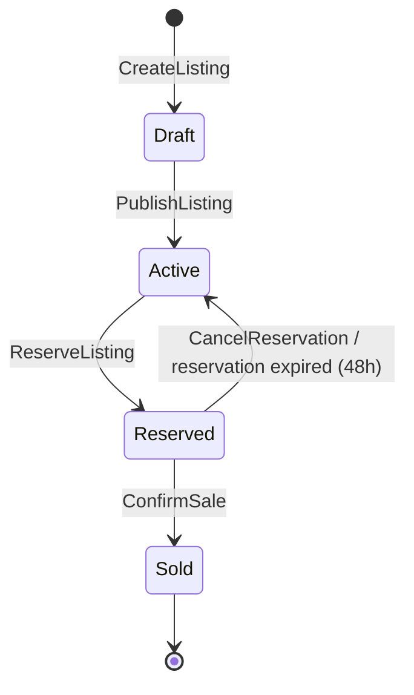
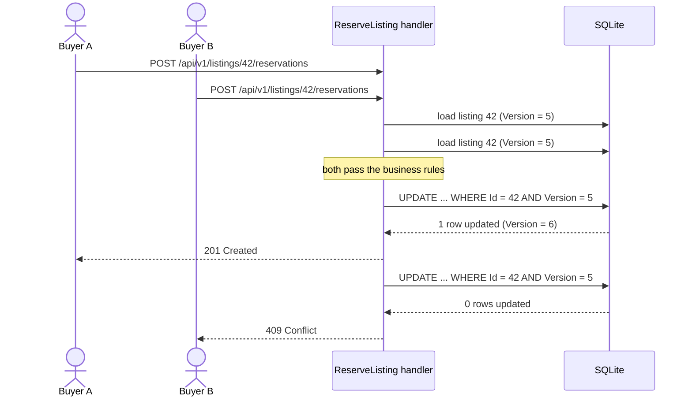
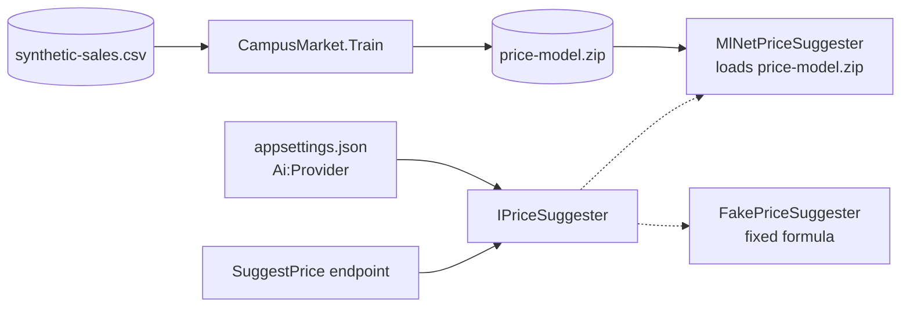

# CampusMarket

A second-hand marketplace for students on campus: textbooks, problem sets, laptops and lab equipment.
Sellers publish listings, buyers reserve them, and an AI module suggests a fair asking price.

---

## Table of contents

1. [Team](#1-team)
2. [Project overview](#2-project-overview)
3. [Use cases](#3-use-cases)
4. [Domain model](#4-domain-model)
5. [Key flows](#5-key-flows)
6. [Architecture](#6-architecture)
7. [AI module: SuggestPrice](#7-ai-module-suggestprice)
8. [Work packages](#8-work-packages)
9. [How we work](#9-how-we-work)

---

## 1. Team

| # | Name | GitHub |
|---|------|--------|
| 1 | Matasel Sara Giulia | `@sara-giulia` |
| 2 | Ilenei Ancuta-Bianca | `@Anca110` |
| 3 | _Name Surname_ | `@username` |
| 4 | _Name Surname_ | `@username` |

## 2. Project overview

| | |
|---|---|
| **Domain** | Second-hand marketplace for students |
| **Aggregates** | `Member`, `Listing`, `Reservation` |
| **Business slices** | 9 (see [Use cases](#3-use-cases)) |
| **Hard rule** | Two buyers reserve the same listing at the same moment: one succeeds, the other gets **409 Conflict** from the `Version` check |
| **AI module** | `SuggestPrice`: ML.NET regression that suggests an asking price with a range |

### Business rules

- A listing has a title, category, condition (`New`, `Good`, `Worn`), asking price, status (`Draft`, `Active`, `Reserved`, `Sold`) and a `Version` for optimistic concurrency.
- A reservation **expires after 48h** (computed with `TimeProvider`).
- A buyer can hold **at most 3 active reservations**.
- A seller **cannot reserve their own listing**.
- A **sold** listing cannot be reserved.
- The AI price is only a **suggestion**: it is never applied automatically, the seller decides.

### Tech stack

- .NET 10, ASP.NET Core **minimal APIs**
- **Vertical slices** with hand-written **CQRS** handlers (commands and queries)
- **Repository + Unit of Work** over **EF Core** with **SQLite**
- `Result<T>` for expected errors (no exceptions for business rule violations)
- `TimeProvider` for anything that depends on the clock
- **xUnit** with hand-written fakes
- **Postman** collections for API tests
- **SonarQube Cloud** for code quality and coverage, with a quality gate of **100% coverage on new code**
- **ML.NET** (`Microsoft.ML`, `Microsoft.ML.FastTree`) for the AI module

## 3. Use cases

### Actors

- **Member**: any registered student. A member acts as a **Seller** when they manage their own listings and as a **Buyer** when they reserve someone else's listing.
- **Visitor**: browses listings without acting on them.



### Use cases mapped to slices

| Use case | Slice | Endpoint (planned) | Rules checked |
|---|---|---|---|
| Register as member | `CreateMember` | `POST /api/v1/members` | unique email |
| Create listing draft | `CreateListing` | `POST /api/v1/listings` | price > 0, valid category and condition |
| Publish listing | `PublishListing` | `POST /api/v1/listings/{id}/publish` | only the owner; only from `Draft` |
| Browse and filter listings | `GetListings` | `GET /api/v1/listings?category=&minPrice=&maxPrice=&page=&pageSize=` | only `Active` listings; paging |
| View listing details | `GetListingById` | `GET /api/v1/listings/{id}` | 404 if missing |
| Reserve listing | `ReserveListing` | `POST /api/v1/listings/{id}/reservations` | not own listing; not sold; max 3 active; **409 on concurrent reservation** |
| Cancel reservation | `CancelReservation` | `POST /api/v1/reservations/{id}/cancel` | only the buyer; only if active |
| Confirm sale | `ConfirmSale` | `POST /api/v1/listings/{id}/confirm-sale` | only the seller; only if `Reserved` |
| View my reservations | `GetMyReservations` | `GET /api/v1/members/{id}/reservations` | expired reservations shown as expired |
| Get suggested price | `SuggestPrice` (AI) | `POST /api/v1/listings/price-suggestion` | suggestion only, never applied |

All endpoints are versioned under `/api/v1/` (see [Design decisions](#design-decisions)).

### Example scenario: reserving a listing

1. Ana publishes "Calculus textbook, Good condition, 40 RON".
2. Mihai sees it in the listing search and reserves it. The listing becomes `Reserved`.
3. Mihai has 48 hours to pick it up. If nothing happens, the reservation expires and the listing becomes `Active` again.
4. When they meet, Ana confirms the sale. The listing becomes `Sold` and can no longer be reserved.

## 4. Domain model



### Listing lifecycle



Any other transition returns an error through `Result<T>` (for example "a sold listing cannot be reserved").

## 5. Key flows

### Hard rule: two buyers reserve the same listing at the same moment

Optimistic concurrency: `Listing.Version` is a concurrency token in EF Core. Both requests read version 5; the first save changes it to 6; the second save finds that the row no longer has version 5, EF Core throws `DbUpdateConcurrencyException`, and the handler turns it into **409 Conflict**.



We will test this with an integration test that runs two reservations in parallel against the same listing and checks that exactly one succeeds.


## 6. Architecture

### Planned folder structure

```
CampusMarket.sln
├── src/
│   ├── CampusMarket.Api/
│   │   ├── Features/                 # one folder per slice
│   │   │   ├── Members/CreateMember/
│   │   │   ├── Listings/CreateListing/
│   │   │   ├── Listings/PublishListing/
│   │   │   ├── Listings/GetListings/
│   │   │   ├── Listings/GetListingById/
│   │   │   ├── Reservations/ReserveListing/
│   │   │   ├── Reservations/CancelReservation/
│   │   │   ├── Listings/ConfirmSale/
│   │   │   ├── Reservations/GetMyReservations/
│   │   │   └── Pricing/SuggestPrice/
│   │   ├── Domain/                   # Member, Listing, Reservation, enums
│   │   ├── Infrastructure/           # DbContext, repositories, UnitOfWork
│   │   ├── Common/                   # Result<T>, Error, endpoint helpers
│   │   └── Program.cs
│   └── CampusMarket.Train/           # console tool: train + evaluate the price model
├── tests/
│   ├── CampusMarket.UnitTests/
│   └── CampusMarket.IntegrationTests/
├── data/
│   └── synthetic-sales.csv           # SYNTHETIC training data
├── postman/
│   └── CampusMarket.postman_collection.json
└── README.md
```

Each slice folder contains the request/response records, the handler and the endpoint mapping for that one use case.

### Design decisions

| Decision | Why |
|---|---|
| Vertical slices | Each use case lives in one folder, so team members rarely edit the same files. |
| Repository + Unit of Work | Handlers do not depend on EF Core directly and can be tested with fakes. |
| `Result<T>` | Business rule violations are expected outcomes, not exceptions. The endpoint maps them to HTTP codes. |
| `TimeProvider` | The 48h expiry can be tested by moving a fake clock forward. |
| `Version` concurrency token | Solves the hard rule without locks. |
| API versioning (`/api/v1/`) | All endpoints live in one versioned route group. If a contract ever has to change in a breaking way, we add `/api/v2/` next to it instead of breaking existing clients and Postman tests. |

## 7. AI module: SuggestPrice

### What it does

The seller enters category, condition, product age and the original list price. The API returns a suggested asking price and a range:

```json
POST /api/v1/listings/price-suggestion
{ "category": "Textbook", "condition": "Good", "ageInMonths": 24, "listPrice": 120 }

200 OK
{ "suggestedPrice": 58.0, "low": 49.5, "high": 66.5, "provider": "MlNet" }
```

The range is the suggestion ± the RMSE measured on the test set. The price is **never** written into the listing automatically.

### Architecture



- `IPriceSuggester` is the interface the handler depends on.
- `MlNetPriceSuggester` loads `price-model.zip` at startup.
- `FakePriceSuggester` uses a fixed formula, so tests never depend on the model.
- The implementation is chosen from `appsettings.json` (`Ai:Provider` = `MlNet` or `Fake`).

### Model and data

| | |
|---|---|
| **Task** | Regression |
| **Trainer** | FastTree (`Microsoft.ML.FastTree`) |
| **Features** | category, condition, age in months, list price |
| **Label** | the price the item actually sold for |
| **Data (phase 1)** | Synthetic CSV, clearly marked as synthetic |
| **Data (phase 2)** | Real sales exported from listings with `Status = Sold` |
| **Split** | 80% train / 20% held-out test |

### Evaluation

- Metrics on the test set: **MAE**, **RMSE** and **R²**.
- Baseline: **the average sold price per category**.
- The `Train` tool prints both the model's metrics and the baseline's, and we record them in this README.
- If the model does not beat the baseline, we will report that honestly as a result.

### Pitfalls we will discuss

- **Cold start**: a category with no sales yet. Fallback: return the category baseline or no suggestion, and say so in the response.
- **Synthetic data**: if we generate prices with a formula, the model just learns our formula, so a good score proves little. We will add noise and say this explicitly.
- **Overfitting**: with a small dataset, the model memorises examples. We check by comparing train and test metrics.

## 8. Work packages

The project is divided into five work packages.

| Package | Slices and tasks | Tests |
|---|---|---|
| **Shared infrastructure** | Solution setup, `Result<T>`, DbContext, repositories, Unit of Work, `TimeProvider` registration, `/api/v1` route group, error → HTTP mapping | Unit tests for `Result<T>` |
| **Member** | `CreateMember` | Handler tests |
| **Listing** | `CreateListing`, `PublishListing`, `GetListings` (filters + paging), `GetListingById` | Domain rules for `Listing`, query tests |
| **Reservation** | `ReserveListing`, `CancelReservation`, `ConfirmSale`, `GetMyReservations`, 48h expiry, max 3 reservations, concurrency 409 | Rules + fake clock tests, parallel reservation integration test |
| **AI module** | Synthetic CSV generator, `CampusMarket.Train` (train + evaluate + baseline), `IPriceSuggester`, ML.NET and Fake implementations, `SuggestPrice` endpoint | Fake suggester tests, endpoint test |

However the work is split, every slice comes with its tests, its Postman requests and a README update, and every pull request is reviewed by another member.

**Order matters:** the shared infrastructure blocks everything else, so it is done first. The AI module does not depend on the database, so it can be worked on in parallel.


## 9. How we work

### Git workflow

- `main` is always working.
- Each task gets its own branch: `feature/reserve-listing`, `fix/listing-paging`.
- Work is merged through a **pull request** reviewed by at least one other member.
- Small commits with clear messages: `Add 48h expiry to Reservation`.

### Definition of done for a slice

- [ ] Endpoint works and returns the right HTTP codes
- [ ] Business rules return `Result` errors, not exceptions
- [ ] Unit tests for the rules
- [ ] Request(s) added to the Postman collection
- [ ] SonarQube Cloud quality gate passed, with **100% coverage on new code**
- [ ] Reviewed and merged into `main`

### Communication

- Weekly team meeting (after the lab) to check progress and plan the next week.
- Tasks tracked as GitHub Issues, one per slice, assigned to whoever picks it up.
- A team chat group for day-to-day questions.


---
