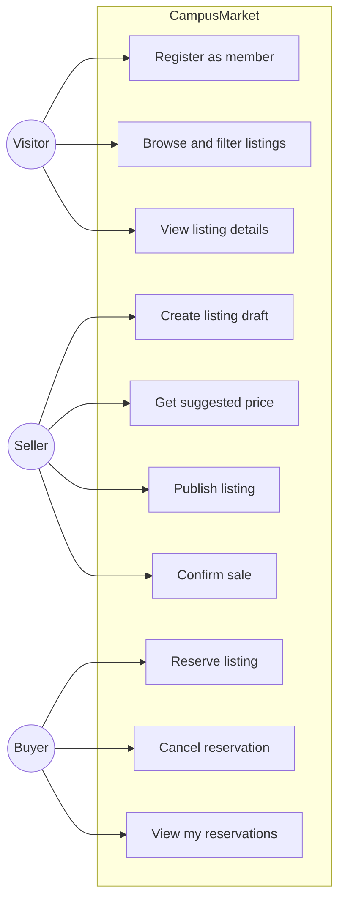
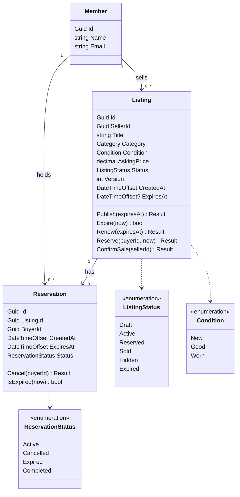
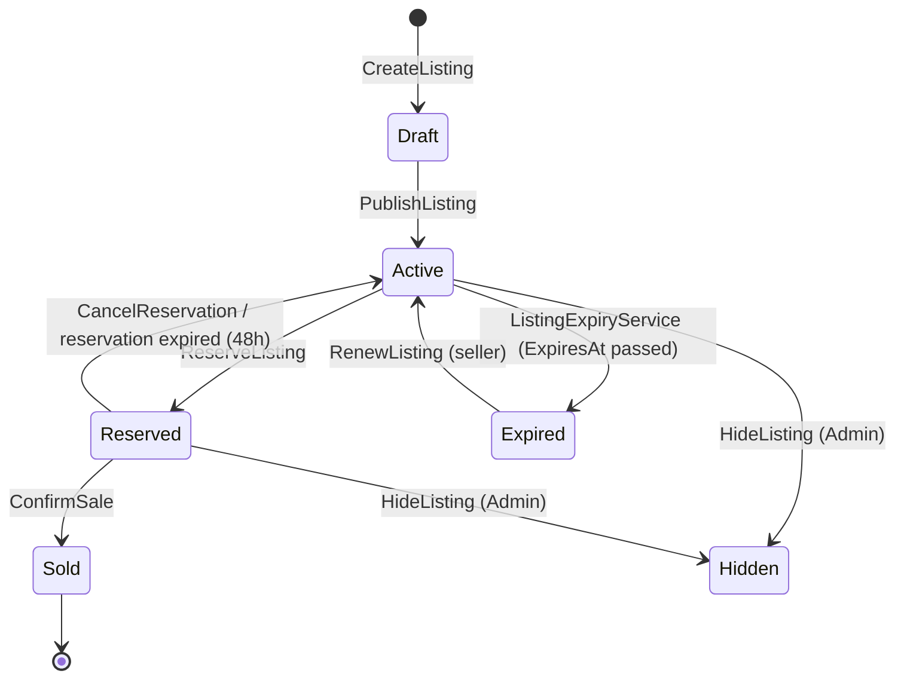

# CampusMarket

A second-hand marketplace for students on campus: textbooks, problem sets, laptops and lab equipment.
Sellers publish listings, buyers reserve them, and an AI module suggests a fair asking price.

## How to run

1. Start PostgreSQL: `docker compose up -d db` (port **5433** on your machine; `appsettings.Development.json` already points at it with `Host=localhost;Port=5433;Database=campusmarket;Username=campusmarket;Password=campusmarket`). Docker must be running. The API creates the tables itself at startup (EF Core migrations), and the data stays in the `campusmarket-pg` volume, so it is not lost when you restart the API or run `docker compose down` (`docker compose down -v` removes it).
2. Start the API: open `CampusMarket.sln` and run the **http** profile, or run `dotnet run --project src/CampusMarket.Api --launch-profile http`. It listens on `http://localhost:5112`.
3. In Postman: **Import** (`Ctrl+O`) the file `postman/CampusMarket.postman_collection.json`.
4. Right-click the **CampusMarket** collection → **Run collection** → **Run**. Every request has tests; the `baseUrl` collection variable is `http://localhost:5112` (change it if your port is different).
5. API documentation (Development only): open `http://localhost:5112/scalar` in a browser to see every endpoint. The OpenAPI document is at `http://localhost:5112/openapi/v1.json`.

Tests: `dotnet test` from the repository root. The integration tests start their own PostgreSQL in Docker (Testcontainers, `postgres:17`, one container for the whole run, one database per test), so **Docker must be running**; they never use the database on port 5433.

### Web frontend

The web interface is in `frontend/` (React + Vite + TypeScript). It needs Node.js 20 or newer and the API running on `http://localhost:5112`.

```
cd frontend
npm install
npm run dev
```

It opens on `http://localhost:5173`. The API allows only the origins in `Cors:AllowedOrigins` (`appsettings.json`: `http://localhost:5173` and the deployed frontend, `https://campus-app-pucf.onrender.com`); for another address set `Cors__AllowedOrigins__2` in the API's environment. To use another API address in the frontend, copy `frontend/.env.example` to `frontend/.env.local` and change `VITE_API_URL`. How the frontend is organised (where to add a page, the API client, login): [frontend/README.md](frontend/README.md).

Admin page `/admin/categories` (menu **Categorii**, Admins only): change the display name, the description and the active flag of the 5 base categories. A deactivated category is not offered for new listings.
Listings that are already `Active` in a deactivated category stay visible: they still appear in `GET /api/v1/listings`, can be filtered by that category (`?category=...`), and `GET /api/v1/listings/{id}` still returns them. Deactivating only stops new listings (create, move by edit, publish of a draft).

### With Docker

1. `docker compose up --build` from the repository root. The API listens on `http://localhost:5080` (port 8080 inside the container).
2. Check that it runs: `docker compose ps` shows `healthy`, and `GET http://localhost:5080/health` answers `200 Healthy`.
3. In Postman, set the `baseUrl` collection variable to `http://localhost:5080` and run the collection.

- `docker-compose.yml` sets `ASPNETCORE_ENVIRONMENT=Development`, so the container uses the development JWT key and the seeded Admin from `appsettings.Development.json`. It is a local demo, not a production setup.
- The container runs as the non-root user of the .NET image. The API talks to the `db` service (PostgreSQL 17, `ConnectionStrings__CampusMarket` in `docker-compose.yml`), whose data is in the named volume `campusmarket-pg`; the uploaded photos are in `/app/data/photos` on the volume `campusmarket-data`. Both are kept after `docker compose down`; `docker compose down -v` removes them and starts from an empty database. `docker compose up -d db` starts only the database (port 5433), for running the API on the host.
- The image has a Docker health check on `/health` (every 30 s). `docker compose ps` shows the container as `healthy` once the API answers and can reach the database, and `unhealthy` after three failed checks.
- The image build fails if one of the trained models (`price-regression.zip`, `category-classification.zip`, `spam-detection.zip`, `similar-listings.zip`) was not copied to `ml-models/`.
- CI has a `docker` job that builds the image, starts it with `docker compose up --wait` (it waits for `healthy`) and calls `/health`.

### Deploy

The `.github/workflows/deploy.yml` workflow runs on every push to `main`
(and on `workflow_dispatch`): first it restores, builds and runs the full
test suite; then — only if the tests pass — it builds the Docker image from
the repository's `Dockerfile` and pushes it to GitHub Container Registry as
`ghcr.io/<owner>/campus-app` with two tags, `latest` and the full commit
SHA (so a specific build can be pinned if `latest` has to be rolled back).
Login to GHCR uses the built-in `GITHUB_TOKEN`
(`permissions: packages: write, contents: read`); no secret has to be
added for the publish step.

As a final step, if a `RENDER_DEPLOY_HOOK` repository secret is set, the
workflow `curl`s it to trigger a redeploy of the Render service. The step
is skipped when the secret is not set, so the pipeline works end-to-end
before Render is wired up and remains idempotent afterwards.

#### Render (free web service) setup

1. In Render, create a new **Web Service** and choose
   **Deploy an existing image from a registry**. Use the image URL
   `ghcr.io/<owner>/campus-app:latest` (replace `<owner>` with the GitHub
   user or org that hosts the repository). The image is public, so no
   registry credentials are needed. Pin to a specific commit SHA tag if a
   reproducible build matters more than always running `latest`.
2. Set the **Health Check Path** to `/health`. Render polls it to decide
   whether the instance is up; the API returns `200 Healthy` only when it
   can reach the database.
3. Leave the port setting on its default. Render passes the public port
   through the `PORT` environment variable; the API reads it at startup
   (`Program.cs`) and binds to `http://0.0.0.0:$PORT`.
4. Configure the environment variables below under
   **Environment → Environment Variables**. Only names appear here; the
   values are chosen in Render and never committed to the repository.

   | Name | Required | Purpose |
   |---|---|---|
   | `ASPNETCORE_ENVIRONMENT` | yes | Set to `Production`. Triggers the JWT fail-fast check below. |
   | `Jwt__Key` | yes | Random string of **at least 32 characters** used to sign JWTs. The API refuses to start in Production if it is missing or shorter than 32 characters. |
   | `Seed__AdminEmail` | optional | Email of the first Admin created on startup. Leave unset to skip the admin seed. |
   | `Seed__AdminPassword` | optional | Password of the first Admin. Needed only when `Seed__AdminEmail` is set. |
   | `ConnectionStrings__CampusMarket` | yes | Npgsql connection string of the PostgreSQL database, for example `Host=<host>;Port=5432;Database=campusmarket;Username=<user>;Password=<password>` (we use a free Neon or Supabase database: the free Render PostgreSQL expires). Add `SSL Mode=Require` for a hosted database. It must be in this key/value form: a `postgresql://...` URL, as Neon shows it, does not work, and the API refuses to start in Production without this variable. The API runs the migrations on this database at startup. There is no default in Production. |
   | `Seed__DemoData` | optional | `true` seeds a demo member and a few published listings when the database is empty, so a fresh Render instance has something to browse. Off by default and never on in tests. |
   | `Seed__DemoPassword` | optional | Password for the demo student account created when `Seed__DemoData=true`. Must be at least 8 characters. If missing or shorter, the demo listings are still seeded but the demo member is skipped (a warning is written to the log). The demo member always has the `Student` role. |

5. Set up the deploy hook (optional but recommended). In Render, open
   **Settings → Deploy Hook** on the service, copy the URL, and add it as a
   GitHub repository secret named `RENDER_DEPLOY_HOOK`. Future pushes to
   `main` will then rebuild the image, push it to GHCR, and tell Render to
   pull it.

#### Free-plan limits to know about

- **Sleep after 15 minutes of inactivity.** The first request after a
  sleep wakes the instance; typical cold-start latency is tens of seconds.
  Render's uptime checks keep the service warmer than no traffic at all,
  but there is no hard guarantee it stays up.
- **No persistent disk on the free tier.** The data is in PostgreSQL, a separate server, so it survives a redeploy or a cold start of the web service (it lasts as long as the PostgreSQL instance does; check the retention limit of the plan you use). The container's own filesystem is reset on every redeploy and every cold start, so the uploaded photos (`/app/data/photos`) are wiped whenever a new image is pulled or the instance is rebuilt; attach a disk (paid tier) if they have to survive. `Seed__DemoData=true` only adds the demo data when the database is empty.
- **One instance, no scaling.** Fine for a student demo, not for traffic.

---

## Table of contents

1. [Team](#1-team)
2. [Project overview](#2-project-overview)
3. [Use cases](#3-use-cases)
4. [Domain model](#4-domain-model)
5. [Key flows](#5-key-flows)
6. [Architecture](#6-architecture)
7. [Work packages](#7-work-packages)
8. [How we work](#8-how-we-work)

Architecture diagrams (Mermaid, in Romanian): [docs/architecture.md](docs/architecture.md)

---

## 1. Team

| # | Name | GitHub |
|---|------|--------|
| 1 | Matasel Sara Giulia | `@sara-giulia` |
| 2 | Ilenei Ancuta-Bianca | `@Anca110` |
| 3 | Coman Carina | `@Carinacoman` |
| 4 | Preutu-Grigore Diana-Smaranda | `@dianapreutu` |

## 2. Project overview

| | |
|---|---|
| **Domain** | Second-hand marketplace for students |
| **Aggregates** | `Member`, `Listing`, `Reservation` |
| **Business slices** | 9 (see [Use cases](#3-use-cases)) |
| **Hard rule** | Two buyers reserve the same listing at the same moment: one succeeds, the other gets **409 Conflict** from the `Version` check |
| **AI module** | `SuggestPrice`: ML.NET regression that suggests an asking price with a range |

### Business rules

- A listing has a title, category, condition (`New`, `Good`, `Worn`), asking price, an optional description (at most 1000 characters), status (`Draft`, `Active`, `Reserved`, `Sold`, `Hidden`, `Expired`) and a `Version` for optimistic concurrency.
- A reservation **expires after 48h** (computed with `TimeProvider`).
- A published listing **expires after 30 days** (`Listings:ExpiryDays`) if it is still `Active`; the seller renews it with one click.
- A buyer can hold **at most 3 active reservations**.
- A seller **cannot reserve their own listing**.
- A **sold** listing cannot be reserved.
- The AI price is only a **suggestion**: it is never applied automatically, the seller decides.

### Tech stack

- .NET 11, ASP.NET Core **minimal APIs** (moved from .NET 10 in week 8; the OpenAPI document is now version 3.2, Scalar shows it as before)
- **Vertical slices** with hand-written **CQRS** handlers (commands and queries)
- **Repository + Unit of Work** over **EF Core** with **PostgreSQL** (Npgsql; migrations run at startup)
- `Result<T>` for expected errors (no exceptions for business rule violations)
- A global exception handler that answers with **ProblemDetails** (see [Error format](#error-format))
- `TimeProvider` for anything that depends on the clock
- **xUnit** with hand-written fakes
- **Postman** collections for API tests
- **SonarQube Cloud** for code quality and coverage, with a quality gate of **100% coverage on new code**
- **ML.NET** (`Microsoft.ML`, `Microsoft.ML.FastTree`, `Microsoft.ML.LightGbm`) for the AI module
- **React + Vite + TypeScript** for the web frontend (`frontend/`), with React Router

## 3. Use cases

### Actors

- **Member**: any registered student. A member acts as a **Seller** when they manage their own listings and as a **Buyer** when they reserve someone else's listing.
- **Visitor**: browses listings without acting on them.



### Use cases mapped to slices

| Use case | Slice | Endpoint (planned) | Rules checked |
|---|---|---|---|
| Register as member | `CreateMember` | `POST /api/v1/members` | unique email |
| Create listing draft | `CreateListing` | `POST /api/v1/listings` | title, category and condition are required (a draft needs the same fields as a published listing); price > 0 |
| Publish listing | `PublishListing` | `POST /api/v1/listings/{id}/publish` | only the owner or an Admin; only from `Draft` |
| Renew expired listing | `RenewListing` | `POST /api/v1/listings/{id}/renew` | only the owner; only from `Expired`; the category must be active |
| Browse and filter listings | `GetListings` | `GET /api/v1/listings?category=&minPrice=&maxPrice=&page=&pageSize=` | only `Active` listings; paging |
| View listing details | `GetListingById` | `GET /api/v1/listings/{id}` | 404 if missing; a `Draft` is seen only by its seller or an Admin (404 for everyone else) |
| Reserve listing | `ReserveListing` | `POST /api/v1/listings/{id}/reservations` | not own listing; only `Active` (so not sold); max 3 active; **409 on concurrent reservation** (`Concurrency.Conflict`, see [Error format](#error-format)) |
| Cancel reservation | `CancelReservation` | `DELETE /api/v1/listings/{id}/reservations/{reservationId}` | the buyer, the seller or an Admin; only if active |
| Confirm sale | `ConfirmSale` | `POST /api/v1/listings/{id}/confirm-sale` | only the seller; only if `Reserved` |
| View my reservations | `GetMyReservations` | `GET /api/v1/members/me/reservations` | only your own (the member comes from the token); expired reservations shown as expired |
| View my listings | `GetMyListings` | `GET /api/v1/members/me/listings` | only your own (the member comes from the token); every status, newest first |
| Live events | `StreamMyEvents` | `GET /api/v1/members/me/events` | only your own events (the member comes from the token); Server-Sent Events, the connection stays open |
| Member | `GetMyProfile` | `GET /api/v1/members/me` | anyone logged in; only their own profile | 200, 401, 404 |
| Member | `UpdateMyProfile` | `PUT /api/v1/members/me` | anyone logged in; only their own name (the email does not change) | 204, 400 `Member.InvalidName`, 401, 404 |
| Member | `GetPublicProfile` | `GET /api/v1/members/{id}/profile` | everyone; no email and no role in the response, only `Active` listings | 200, 404 `Member.NotFound` |
| Get suggested price | `SuggestPrice` (AI) | `POST /api/v1/listings/price-suggestion` | suggestion only, never applied |
| Get suggested category | `SuggestCategory` (AI) | `POST /api/v1/listings/category-suggestion` | suggestion only, the seller still picks the category |
| Report a listing | `ReportListing` | `POST /api/v1/listings/{id}/reports` | not own listing; only `Active` or `Reserved`; at most once per member |
| See reported listings | `GetReportedListings` | `GET /api/v1/moderation/listings` | Admins only; hidden listings left out |
| Hide a listing | `HideListing` | `POST /api/v1/moderation/listings/{id}/hide` | Admins only; only `Active` or `Reserved` |
| Review the seller | `AddReview` | `POST /api/v1/listings/{id}/reviews` | only the buyer; only after the sale is confirmed; rating 1 to 5; once per sale |
| See a member's reviews | `GetMemberReviews` | `GET /api/v1/members/{id}/reviews` | public; newest first, with the average rating |
| Write to the seller | `StartConversation` | `POST /api/v1/listings/{id}/conversations` | not own listing; a new conversation only on an `Active` or `Reserved` listing; one conversation per buyer and listing |
| Answer in a conversation | `SendMessage` | `POST /api/v1/conversations/{id}/messages` | only the buyer and the seller |
| Read a conversation | `GetConversation` | `GET /api/v1/conversations/{id}` | only the buyer and the seller |
| See my conversations | `GetMyConversations` | `GET /api/v1/members/me/conversations` | as buyer and as seller; the latest message first |
| Add a photo | `UploadPhoto` | `POST /api/v1/listings/{id}/photos` | only the seller; JPEG, PNG or WebP; at most 2 MB; at most 5 per listing |
| Remove a photo | `DeletePhoto` | `DELETE /api/v1/listings/{id}/photos/{photoId}` | only the seller |
| Reorder the photos | `ReorderPhotos` | `PUT /api/v1/listings/{id}/photos/order` | only the seller; the ids must be exactly the photos of the listing |
| See the photos | `GetListingPhotos`, `GetPhotoFile` | `GET /api/v1/listings/{id}/photos`, `GET /api/v1/photos/{id}` | the photo list follows the listing's visibility (a draft: seller or Admin only); the image itself is public |

All endpoints are versioned under `/api/v1/` (see [Design decisions](#design-decisions)).

### Implemented so far

| Resource | Slice | Endpoint | Who may call it | Responses |
|---|---|---|---|---|
| Listing | `CreateListing` | `POST /api/v1/listings` | anyone logged in; the seller is the user in the token | 201 + `Location`, 400, 401, 409 |
| Listing | `GetListingById` | `GET /api/v1/listings/{id}` | everyone; a `Draft` only for its seller or an Admin | 200, 404 (also a draft that is not yours) |
| Listing | `GetListings` | `GET /api/v1/listings` | everyone | 200, 400 (see [Searching listings](#searching-listings)) |
| Listing | `UpdateListing` | `PUT /api/v1/listings/{id}` | the seller or an Admin | 204, 400 (also `Listing.CategoryRequired`, `Listing.ConditionRequired`), 401, 403 `Listing.NotOwner`, 404 |
| Listing | `DeleteListing` | `DELETE /api/v1/listings/{id}` | the seller or an Admin | 204, 401, 403 `Listing.NotOwner`, 404 |
| Member | `CreateMember` | `POST /api/v1/members` | Admins only (students use `Register`) | 201 + `Location`, 400, 401, 403, 409 |
| Member | `GetMemberById` | `GET /api/v1/members/{id}` | everyone | 200, 404 |
| Member | `GetMembers` | `GET /api/v1/members` | everyone | 200 |
| Member | `UpdateMember` | `PUT /api/v1/members/{id}` | the member or an Admin | 204, 400, 401, 403 `Member.NotOwner`, 404, 409 |
| Member | `DeleteMember` | `DELETE /api/v1/members/{id}` | the member or an Admin | 204, 401, 403 `Member.NotOwner`, 404 |
| Listing | `PublishListing` | `POST /api/v1/listings/{id}/publish` | the seller or an Admin | 204, 400 `Listing.NotDraft`, 401, 403 `Listing.NotOwner`, 404 |
| Listing | `RenewListing` | `POST /api/v1/listings/{id}/renew` | the seller only (not an Admin) | 204 (back to `Active`, new `expiresAt`), 400 `Listing.NotExpired` / `Listing.CategoryInactive`, 401, 403 `Listing.NotOwner`, 404 `Listing.NotFound` |
| Listing | `SuggestPrice` | `POST /api/v1/listings/price-suggestion` | anyone logged in | 200 `{ suggestedPrice }` (whole lei, ≥ 1), 400 (also `Listing.CategoryRequired`, `Listing.ConditionRequired`), 401 |
| Listing | `SuggestCategory` | `POST /api/v1/listings/category-suggestion` | anyone logged in | 200 `{ category, confidence }` (confidence 0–1; `category` is null when the confidence is below `Ml:Category:MinConfidence`, 0.6, chosen on validation data), 400, 401 |
| Listing | `GetSimilarListings` | `GET /api/v1/listings/{id}/similar` | everyone | 200 `{ items: [{ id, title, category, condition, price, similarity }] }` (at most 5 Active listings, never the listing itself, most similar first, similarity 0–1), 404 `Listing.NotFound` |
| Report | `ReportListing` | `POST /api/v1/listings/{id}/reports` | anyone logged in; the reporter is the user in the token | 201, 400, 401, 404, 409 `Report.AlreadyExists` |
| Moderation | `GetReportedListings` | `GET /api/v1/moderation/listings?page=&pageSize=` | Admins only | 200, 400, 401, 403 |
| Moderation | `HideListing` | `POST /api/v1/moderation/listings/{id}/hide` | Admins only | 204, 400 `Listing.AlreadyHidden` / `Listing.CannotHide`, 401, 403, 404 |
| Review | `AddReview` | `POST /api/v1/listings/{id}/reviews` | the buyer of the sold listing | 201 + `Location`, 400, 401, 403 `Review.NotBuyer`, 404, 409 `Review.AlreadyExists` |
| Review | `GetMemberReviews` | `GET /api/v1/members/{id}/reviews?page=&pageSize=` | everyone | 200, 400, 404 |
| Conversation | `StartConversation` | `POST /api/v1/listings/{listingId}/conversations` | anyone logged in except the seller | 201 + `Location` (first message, or the next one if the conversation exists), 400 `Conversation.OwnListing`, `Conversation.ListingNotAvailable`, `Message.Empty`, `Message.TooLong`, 401, 404 |
| Conversation | `SendMessage` | `POST /api/v1/conversations/{id}/messages` | the buyer or the seller | 201 + `Location`, 400, 401, 403 `Conversation.NotParticipant`, 404 `Conversation.NotFound` |
| Conversation | `GetConversation` | `GET /api/v1/conversations/{id}` | the buyer or the seller | 200, 401, 403 `Conversation.NotParticipant`, 404 `Conversation.NotFound` |
| Conversation | `GetMyConversations` | `GET /api/v1/members/me/conversations` | anyone logged in; only their own conversations | 200, 401 |
| Photo | `UploadPhoto` | `POST /api/v1/listings/{listingId}/photos` (`multipart/form-data`, field `file`) | the seller | 201 + `Location`, 400 `Photo.LimitReached`, `Photo.Empty`, `Photo.TooLarge`, `Photo.InvalidFormat`, 401, 403 `Photo.NotSeller`, 404, 415 (not a form), 503 `Photo.StorageFailed` |
| Photo | `GetListingPhotos` | `GET /api/v1/listings/{listingId}/photos` | everyone; the photos of a `Draft` only for its seller or an Admin | 200 (sorted by `position`), 404 (also a draft that is not yours) |
| Photo | `GetPhotoFile` | `GET /api/v1/photos/{id}` | everyone | 200 (the image), 404 `Photo.NotFound` |
| Photo | `DeletePhoto` | `DELETE /api/v1/listings/{listingId}/photos/{photoId}` | the seller | 204, 401, 403 `Photo.NotSeller`, 404 |
| Photo | `ReorderPhotos` | `PUT /api/v1/listings/{listingId}/photos/order` (body `{ "photoIds": [...] }`) | the seller | 200 (the photos in the new order), 400 `Photo.OrderMismatch`, 401, 403 `Photo.NotSeller`, 404 |
| Reservation | `ReserveListing` | `POST /api/v1/listings/{id}/reservations` | anyone logged in; the buyer is the user in the token | 201 + `Location`, 400, 401, 404 |
| Reservation | `CancelReservation` | `DELETE /api/v1/listings/{id}/reservations/{reservationId}` | the buyer, the seller or an Admin | 204, 400 `Reservation.NotActive`, 401, 403 `Reservation.NotAllowed`, 404 |
| Reservation | `ConfirmSale` | `POST /api/v1/listings/{id}/reservations/{reservationId}/confirm` | the seller or an Admin | 204, 400 `Reservation.NotActive` / `Reservation.Expired` / `Listing.Sold`, 401, 403 `Listing.NotOwner`, 404 |
| Reservation | `GetMyReservations` | `GET /api/v1/members/me/reservations` | anyone logged in; only their own reservations | 200 `{ items, count }` (each item has `reviewed`), 401 |
| Listing | `GetMyListings` | `GET /api/v1/members/me/listings` | anyone logged in; only their own listings, in every status, newest first | 200 `{ items, count }` (each item has `expiresAt`, null for a draft never published), 401 |
| Member | `StreamMyEvents` | `GET /api/v1/members/me/events` | anyone logged in; only their own events | 200 `text/event-stream` (stays open: `ping`, `notification`, `message`), 401 |
| Auth | `Register` | `POST /api/v1/auth/register` | everyone, at most 5 registrations per minute per IP | 201 + `Location`, 400, 409, 429 |
| Auth | `Login` | `POST /api/v1/auth/login` | everyone, at most 5 attempts per minute per IP | 200, 401, 429 |
| Auth | `ChangePassword` | `POST /api/v1/auth/change-password` | anyone logged in; only their own password | 204, 400 `Auth.InvalidCredentials` / `Auth.WeakPassword` / `Auth.PasswordsDoNotMatch`, 401, 404 `Member.NotFound` |
| Auth | `Refresh` | `POST /api/v1/auth/refresh` | anyone with a valid refresh token | 200, 401 `Auth.InvalidRefreshToken` |
| Auth | `Logout` | `POST /api/v1/auth/logout` | anyone with a valid refresh token | 204, 401 `Auth.InvalidRefreshToken` |
| Auth | `ForgotPassword` | `POST /api/v1/auth/forgot-password` | everyone, rate-limited like `Login` | 202 with the same body whether the email exists or not, 429 |
| Auth | `ResetPassword` | `POST /api/v1/auth/reset-password` | anyone with a valid reset token | 204, 400 `Auth.WeakPassword` / `Auth.PasswordsDoNotMatch` / `Auth.InvalidResetToken` |
| Favorite | `AddFavorite` | `POST /api/v1/members/me/favorites/{listingId}` | anyone logged in; the member is the user in the token | 201 + `Location`, 400, 401, 404, 409 |
| Favorite | `RemoveFavorite` | `DELETE /api/v1/members/me/favorites/{listingId}` | anyone logged in; only their own favorites | 204, 401, 404 `Favorite.NotFound` |
| Favorite | `GetMyFavorites` | `GET /api/v1/members/me/favorites?page=&pageSize=` | anyone logged in; only their own favorites | 200, 400, 401 |
| Admin | `GetPriceAccuracy` | `GET /api/v1/admin/ml/price-accuracy` | Admins only | 200 `{ count, mae, mape, perCategory, lastRecords }` (`mae`/`mape` null when `count` is 0), 401, 403 |
| Admin | `GetPriceFeedback` | `GET /api/v1/admin/ml/price-feedback` | Admins only | 200 `text/csv` file `feedback.csv` (header `Title,Description,Category,Condition,Price,IsSpam,TemplateId`, one row per `SaleRecord` whose listing still exists; header only when there are none), 401, 403 |
| Admin | `GetAdminMetrics` | `GET /api/v1/admin/metrics` | Admins only | 200 `{ endpoints: [{ route, requests, errors, averageMs, p95Ms, statusCodes }], mlPredictions: [{ model, count, averageMs }] }`, 401, 403 |
| Category | `GetCategories` | `GET /api/v1/categories` | everyone | 200 `{ items: [{ key, displayName, description, isActive }], count }` (all 5 base categories, active or not) |
| Category | `UpdateCategory` | `PUT /api/v1/categories/{category}` (`{ displayName, description, isActive }`) | Admins only | 204, 400 `Category.IsActiveRequired` / `Category.DisplayNameEmpty` / `Category.DisplayNameTooLong` / `Category.DescriptionTooLong`, 401, 403, 404 `Category.NotFound`, 409 `Category.LastActive` |
| Notification | `GetMyNotifications` | `GET /api/v1/members/me/notifications?unreadOnly=&page=&pageSize=` | anyone logged in; only their own notifications | 200 `{ items, count, totalCount, unreadCount, page, pageSize }`, 400, 401 |
| Notification | `MarkNotificationRead` | `POST /api/v1/members/me/notifications/{id}/read` | anyone logged in; only their own notifications | 204, 401, 404 `Notification.NotFound` |
| Notification | `MarkAllNotificationsRead` | `POST /api/v1/members/me/notifications/read-all` | anyone logged in; only their own notifications | 204, 401 |
| Health | health check | `GET /health` (outside `/api/v1`) | everyone | 200 `Healthy` (plain text) when the API can reach the database, 503 `Unhealthy` when it cannot |
| Health | live check | `GET /health/live` (outside `/api/v1`) | everyone | 200 `Healthy` (plain text) as long as the app runs; it runs no checks |
| Health | ready check | `GET /health/ready` (outside `/api/v1`) | everyone | 200 `Healthy` (plain text) when the database is reachable and the 4 ML models (`price-regression.zip`, `category-classification.zip`, `spam-detection.zip`, `similar-listings.zip`) are present, 503 `Unhealthy` otherwise |

GET endpoints are public (including `GET /api/v1/members/{id}/reviews`), except `GET /api/v1/members/me`, `GET /api/v1/members/me/reservations`, `GET /api/v1/members/me/listings`, `GET /api/v1/members/me/events`, `GET /api/v1/members/me/favorites`, `GET /api/v1/moderation/listings` and `GET /api/v1/admin/ml/price-accuracy` (the last two Admins only). POST, PUT and DELETE need the token from `POST /api/v1/auth/login` in the `Authorization: Bearer <token>` header: without it the API answers 401. A logged-in user who is not the owner gets 403; an Admin passes every ownership check except `POST /api/v1/listings/{id}/renew`, which only the seller can call.

### Searching listings

`GET /api/v1/listings` filters, searches and pages the listings. Every parameter is optional. Only `Active` listings are returned: drafts, reserved and sold listings are hidden.

| Parameter | Meaning | Default |
|---|---|---|
| `category` | `Textbook`, `Notes`, `Electronics`, `LabEquipment` or `Other` | all categories |
| `condition` | `New`, `Good` or `Worn` | all conditions |
| `minPrice` | lowest price, inclusive | no limit |
| `maxPrice` | highest price, inclusive | no limit |
| `search` | text in the title, upper and lower case ignored | no search |
| `sort` | `newest`, `price_asc` or `price_desc` | `newest` |
| `page` | page number, from 1 | `1` |
| `pageSize` | listings per page, from 1 to 100 | `20` |

Listings come newest first by default (`createdAt` descending, then `id`); with `sort=price_asc` or `sort=price_desc` they are ordered by price, then `id`. The same query always returns the same pages.

Example: `GET /api/v1/listings?category=Textbook&minPrice=10&maxPrice=100&search=oop&page=1&pageSize=20`

```json
{
  "items": [ { "id": "...", "title": "OOP textbook", "category": "Textbook", "price": 40, "...": "..." } ],
  "count": 1,
  "totalCount": 1,
  "page": 1,
  "pageSize": 20
}
```

### Listings cache

`GET /api/v1/listings` is cached for 30 seconds per query string. Every successful change of a listing (create, update, delete, publish, reserve, cancel reservation, confirm sale, hide) clears the cache, so the next search sees it at once. The reservation expiry job changes listings without going through an endpoint, so its changes can appear up to 30 seconds later, which is acceptable.

A single listing (`GET /api/v1/listings/{id}`) also returns `description`:

```json
{
  "id": "...",
  "title": "OOP textbook",
  "category": "Textbook",
  "condition": "Good",
  "price": 40,
  "status": "Active",
  "version": 1,
  "createdAt": "...",
  "description": "Looks almost new, no highlights."
}
```

`count` is the number of listings on this page; `totalCount` is the number of listings that match the filters, on all pages.

| Error | When |
|---|---|
| 400 `Listings.InvalidPage` | `page` is less than 1 |
| 400 `Listings.InvalidPageSize` | `pageSize` is outside 1–100 |
| 400 `Listings.InvalidPriceRange` | `minPrice` is greater than `maxPrice` |
| 400 `Listings.InvalidSort` | `sort` is not `newest`, `price_asc` or `price_desc` |
| 400 `Request.Invalid` (ProblemDetails, from ASP.NET Core) | `category` or `condition` is not one of the values above |

Listings (with their reservations) and members are stored in PostgreSQL through EF Core, behind `IListingRepository` / `IMemberRepository` and `IUnitOfWork`. Endpoints depend only on the handlers. Errors from the handlers are returned as `{ "code", "message", "type" }`; everything else as ProblemDetails (see [Error format](#error-format)).

### Authentication

1. `POST /api/v1/auth/register` with `{ "name", "email", "password", "confirmPassword" }`. The password needs at least 8 characters and `confirmPassword` must be exactly the same. Every new account has the role `Student`.
2. `POST /api/v1/auth/login` with `{ "email", "password" }` returns `{ "token", "expiresAt", "refreshToken" }`. The access token is valid for 15 minutes, the refresh token for 7 days.
3. Send the access token on every protected request: `Authorization: Bearer <token>`.
4. When the access token expires, `POST /api/v1/auth/refresh` with `{ "refreshToken" }` returns a new `{ "token", "expiresAt", "refreshToken" }`, without the password. The old refresh token stops working (rotation), so always keep the new one.
5. `POST /api/v1/auth/logout` with `{ "refreshToken" }` cancels the refresh token (204). After that it can no longer be used.
6. `POST /api/v1/auth/change-password` with `{ "currentPassword", "newPassword", "confirmNewPassword" }` (logged in) changes your password (204). A wrong current password gives 400 `Auth.InvalidCredentials`; the new password follows the same rules as Register (`Auth.WeakPassword`, `Auth.PasswordsDoNotMatch`).

- Passwords are stored only as a hash, never returned.
- Refresh tokens are long random strings (64 bytes from `RandomNumberGenerator`). Only their SHA-256 hash is stored, so a copy of the database cannot be used to log in. An unknown, expired, already used or cancelled refresh token gets the same 401 `Auth.InvalidRefreshToken`.
- A wrong email and a wrong password get the same 401 `Auth.InvalidCredentials`, so nobody can find out which emails have an account.
- Login allows 5 attempts per minute from the same IP, then 429.
- Roles: `Student` and `Admin`. In the Development environment an Admin account is created at startup from `Seed:AdminEmail` / `Seed:AdminPassword` in `appsettings.Development.json`. The JWT key is also there, for development only.
- CORS: browsers may call the API only from the origins in `Cors:AllowedOrigins` (the web frontend: `http://localhost:5173` in development, `https://campus-app-pucf.onrender.com` deployed). Any header and method is allowed, `Location` is readable by the frontend, and no cookies are used: the token always goes in the `Authorization` header. The CORS headers are also on error answers (401, 404, 500), so the frontend can read the error.

### Email

Transactional emails (password-reset link, "your password was changed" notice) go through `IEmailSender` (`Common/Email/`). Two implementations are registered: `SmtpEmailSender` (`Infrastructure/Mailing/`, `System.Net.Mail`) when `Email:Host` is set in configuration, and `LoggingEmailSender` otherwise — the fallback only writes `email to {to}: {subject}` to the log and drops the body, so no reset link ever appears in logs or tests.

- **Local dev with Mailpit.** `docker-compose.yml` now ships a `mailpit` service (image `axllent/mailpit`). The web UI is at **`http://localhost:8025`** (every email the API sends appears there, no credentials). The API container points at it via `Email__Host=mailpit`, `Email__Port=1025`, `Email__UseSsl=false`.
- **Environment variables (names only; values set in your own environment, never committed):**

  | Name | Meaning |
  |---|---|
  | `Email__Host` | SMTP host. Leave unset to keep the logger-only fallback. |
  | `Email__Port` | SMTP port (default 587). |
  | `Email__From` | From address (default `noreply@campusmarket.local`). |
  | `Email__UseSsl` | `true`/`false` (default `true`). |
  | `Email__Username` | SMTP auth username. **Only** read from the environment, never from appsettings. |
  | `Email__Password` | SMTP auth password. Same rule as `Email__Username`. |
  | `Frontend__BaseUrl` | Base URL of the frontend, embedded in the reset link as `{BaseUrl}/reset-password?token=...` (default `http://localhost:5173`). |

- **Password reset flow.** `POST /api/v1/auth/forgot-password { email }` always answers **202** with the same body whether the email exists or not (no user enumeration); rate-limited by the same `login` policy. If a member is found, a 32-byte URL-safe-Base64 token is saved as its SHA-256 hash in `PasswordResetTokens` (migration `InitialPostgres`), valid 30 minutes, and the reset link is emailed. `POST /api/v1/auth/reset-password { token, newPassword, confirmNewPassword }` → **204**; same password rules as `Register` (`Auth.WeakPassword`, `Auth.PasswordsDoNotMatch`); unknown / expired / already-used token → **400** `Auth.InvalidResetToken`. On success the token is marked used, every active refresh token of the member is revoked, and a "your password was changed" email is sent (the password itself never appears in the body).

### Error codes

| Code | HTTP | When |
|---|---|---|
| `Auth.WeakPassword` | 400 | the password has fewer than 8 characters |
| `Auth.InvalidCredentials` | 401 | wrong email or password (same answer for both) |
| `Auth.PasswordsDoNotMatch` | 400 | `confirmPassword` is not the same as `password` |
| `Auth.InvalidRefreshToken` | 401 | the refresh token is unknown, expired, already used by a refresh, or cancelled by logout |
| `Auth.InvalidResetToken` | 400 | the password-reset token is unknown, expired or already used (same answer for all three, no enumeration) |
| `Member.EmailTaken` | 409 | another member already uses the email |
| `Member.NotFound` | 404 | no member with that id, also when the buyer of a reservation does not exist |
| `Member.NotOwner` | 403 | you change or delete a profile that is not yours |
| `Listing.NotFound` | 404 | no listing with that id |
| `Listing.NotOwner` | 403 | you change, delete, publish or renew a listing that is not yours |
| `Listing.NotDraft` | 400 | you publish a listing that is not a draft |
| `Listing.NotExpired` | 400 | you renew a listing that is not `Expired` |
| `Listing.NotActive` | 400 | you reserve a listing that is not `Active` (draft, reserved or sold) |
| `Reservation.OwnListing` | 400 | the seller reserves their own listing |
| `Reservation.LimitReached` | 400 | the buyer already has 3 active reservations |
| `Reservation.NotFound` | 404 | the listing has no reservation with that id |
| `Reservation.NotAllowed` | 403 | you cancel a reservation and you are not the buyer, the seller or an Admin |
| `Reservation.NotActive` | 400 | you cancel or confirm a reservation that is not active |
| `Reservation.Expired` | 400 | you confirm a reservation past its 48-hour expiry |
| `Listing.Sold` | 400 | you change a listing that has already been sold |
| `Money.TooHigh` | 400 | the price is above 100000 lei |
| `Listings.InvalidPage`, `Listings.InvalidPageSize`, `Listings.InvalidPriceRange` | 400 | wrong search parameters (see above) |
| `Listings.InvalidSort` | 400 | sort is not newest, price_asc or price_desc |
| `Favorite.OwnListing` | 400 | the seller adds their own listing to favorites |
| `Favorite.ListingNotAvailable` | 400 | the listing is still a draft, or it was hidden by an Admin |
| `Favorite.AlreadyExists` | 409 | the listing is already in your favorites |
| `Favorite.NotFound` | 404 | you remove a listing that is not in your favorites |
| `Favorites.InvalidPage`, `Favorites.InvalidPageSize` | 400 | wrong paging parameters for `GET /api/v1/members/me/favorites` (same rules as the listing search) |
| `Report.OwnListing` | 400 | the seller reports their own listing |
| `Report.ListingNotAvailable` | 400 | the listing is a draft, sold or hidden |
| `Report.ReasonEmpty`, `Report.ReasonTooLong` | 400 | the reason is empty or longer than 500 characters |
| `Report.AlreadyExists` | 409 | you have already reported this listing |
| `Listing.AlreadyHidden` | 400 | an Admin hides a listing that is already hidden |
| `Listing.CannotHide` | 400 | an Admin hides a draft or a sold listing |
| `Moderation.InvalidPage`, `Moderation.InvalidPageSize` | 400 | wrong paging parameters for `GET /api/v1/moderation/listings` |
| `Review.SaleNotCompleted` | 400 | the listing is not sold yet |
| `Review.NotBuyer` | 403 | you review a sale and you are not its buyer (also the seller) |
| `Review.InvalidRating` | 400 | the rating is not between 1 and 5 |
| `Review.CommentTooLong` | 400 | the comment is longer than 500 characters |
| `Review.AlreadyExists` | 409 | the sale has already been reviewed |
| `Reviews.InvalidPage`, `Reviews.InvalidPageSize` | 400 | wrong paging parameters for `GET /api/v1/members/{id}/reviews` |
| `Category.NotFound` | 404 | `PUT /api/v1/categories/{category}` with a key that is not one of the 5 base categories |
| `Category.IsActiveRequired` | 400 | the body of `PUT /api/v1/categories/{category}` has no `isActive` |
| `Category.DisplayNameEmpty` | 400 | the display name of a category is missing, empty or only spaces |
| `Category.DisplayNameTooLong` | 400 | the display name of a category is longer than 100 characters |
| `Category.DescriptionTooLong` | 400 | the description of a category is longer than 500 characters |
| `Category.LastActive` | 409 | an Admin deactivates the last active category (at least one must stay active) |
| `Listing.CategoryRequired`, `Listing.ConditionRequired` | 400 | `category` or `condition` is missing (null) on create, update or price suggestion; a draft needs them like a published listing |
| `Photo.StorageFailed` | 503 | the photo file could not be written to the storage; nothing was saved, try again |
| `Photo.OrderMismatch` | 400 | the list of `PUT .../photos/order` is not exactly the photos of the listing (missing, unknown or repeated id) |
| `Listing.CategoryInactive` | 400 | you create a listing in a deactivated category, move a listing into one, or publish a draft that is in one |

Validation errors of the data itself (empty title, price 0, invalid email, short name) are 400 with codes such as `Listing.TitleEmpty`, `Listing.DescriptionTooLong` (more than 1000 characters) or `Member.InvalidName`.

### Error format

Every error body has a `code`. There are two shapes, depending on who answers:

| Who answers | Shape | Examples |
|---|---|---|
| a handler (a business rule, `Result` failure) | `{ "code", "message", "type" }` | all the codes in the table above |
| ASP.NET itself, or an exception nobody caught | ProblemDetails (`Content-Type: application/problem+json`) with `type`, `title`, `status`, `detail`, `instance`, `traceId` and `code` | see below |

| Code | HTTP | When |
|---|---|---|
| `Auth.Unauthorized` | 401 | no token, or the token is invalid or expired |
| `Auth.Forbidden` | 403 | the `Admin` policy refuses the user (`POST /api/v1/members` as a student) |
| `Route.NotFound` | 404 | no endpoint at that URL |
| `Request.MethodNotAllowed` | 405 | the URL exists, but not with that HTTP method |
| `Request.Invalid` | 400 | the request cannot be read (bad JSON, unknown enum value such as `"category": "Banana"`) |
| `Request.TooManyRequests` | 429 | more than 5 login attempts per minute |
| `Concurrency.Conflict` | 409 | someone else saved the same listing at the same moment (`DbUpdateConcurrencyException`, see [Key flows](#5-key-flows)) |
| `Server.Error` | 500 | any other exception; the details go only to the log, never to the client |

```json
{
  "type": "https://tools.ietf.org/html/rfc9110#section-15.5.10",
  "title": "Conflict",
  "status": 409,
  "detail": "The data was changed by another request at the same time. Load it again and retry.",
  "instance": "/api/v1/listings/42/reservations",
  "code": "Concurrency.Conflict",
  "traceId": "00-6f1c...-01"
}
```

The code is in `Infrastructure/ErrorHandling/`: `GlobalExceptionHandler` turns exceptions into ProblemDetails, and `AddCampusMarketErrorHandling` adds `code`, `instance` and `traceId` to every ProblemDetails. In `Program.cs`, `UseExceptionHandler` and `UseStatusCodePages` come before authentication, authorization and rate limiting, so the empty 401/403/429 answers get a body too.

**Correlation id.** Every response has an `X-Correlation-Id` header. It is the value the client sent in the same header, or a new Guid when there is none, and it is written in every console log line of the request (`CorrelationId` in the log scope). The code is in `Infrastructure/Logging/CorrelationIdMiddleware.cs`, the first middleware in `Program.cs`, so error responses have the header too.

### Example scenario: reserving a listing

1. Ana publishes "Calculus textbook, Good condition, 40 RON".
2. Mihai sees it in the listing search and reserves it. The listing becomes `Reserved`.
3. Mihai has 48 hours to pick it up. If nothing happens, the reservation expires and the listing becomes `Active` again.
4. When they meet, Ana confirms the sale. The listing becomes `Sold` and can no longer be reserved.

### Reservation expiry

A background job sweeps the database periodically and expires every active reservation whose 48 h window is over: the reservation's status becomes `Expired` and the listing goes back to `Active`, so another buyer can reserve it. The sweep is a system job, not a user action; it has no HTTP endpoint.

Two settings under `ReservationExpiry` in `appsettings.json` control the job:

| Setting | Default | Meaning |
|---|---|---|
| `Enabled` | `true` | Register the background service. Integration tests set it to `false` so the job never runs during the other tests. |
| `Interval` | `00:05:00` | How often the sweep runs (any `TimeSpan`). |

### Listing expiry

A published listing stays in the search for `Listings:ExpiryDays` days (default 30). `PublishListing` and `RenewListing` set `Listing.ExpiresAt` to now + that many days. `ListingExpiryService` (a background service built like `ReservationExpiryService`: `TimeProvider`, `PeriodicTimer`, a scope per run, source-generated logs) runs `ExpireListingsHandler`, which moves every `Active` listing whose `ExpiresAt` has passed to `Expired`. `Reserved`, `Sold`, `Draft` and `Hidden` listings never expire; a reserved listing that goes back to `Active` after its `ExpiresAt` (reservation cancelled or expired) expires on the next run.

For each expired listing the seller gets a `ListingExpired` notification ("Your listing <title> expired", saved in the same commit) and, after the commit, an email with a link to `{Frontend:BaseUrl}/my/listings`. A failed email is logged and does not undo the expiry. The run also clears the listings cache.

An `Expired` listing is treated like a `Hidden` one: it is not in the search, the similar listings, the seller's public profile, the favorites lists or the moderation list, and it cannot be reserved, reported, saved to favorites or start a conversation. The seller still sees it in My listings, marked "Expirat", with a "Reînnoiește" button (`POST /api/v1/listings/{id}/renew`); an active listing shows "Expiră în X zile". Renewing checks the category like publishing does (`Listing.CategoryInactive`).

| Setting | Default | Meaning |
|---|---|---|
| `Listings:ExpiryDays` | `30` | How long a published or renewed listing stays `Active` (at least 1, checked at start). |
| `ListingExpiry:Enabled` | `true` | Register the background service. Integration tests set it to `false`. |
| `ListingExpiry:Interval` | `01:00:00` | How often the sweep runs. |

Migration `AddListingExpiry` (on top of `AddPhotoPosition`) adds the nullable `ExpiresAt` column and gives every existing `Active` and `Reserved` listing `ExpiresAt` = migration time + 30 days, so nothing expires right after the deploy.

### Favorites

A member saves listings to find them again later. The member is always the user in the token, so nobody can see or change someone else's favorites.

- `POST /api/v1/members/me/favorites/{listingId}` saves a listing: 201 with `{ id, listingId, createdAt }`. A listing is saved at most once (409 `Favorite.AlreadyExists`), the seller cannot save their own listing (400 `Favorite.OwnListing`) and a draft cannot be saved (400 `Favorite.ListingNotAvailable`). Active, reserved and sold listings can be saved.
- `DELETE /api/v1/members/me/favorites/{listingId}` removes it: 204, or 404 `Favorite.NotFound`.
- `GET /api/v1/members/me/favorites?page=1&pageSize=20` lists them, newest first, with the same paging rules as the listing search (`page` from 1, `pageSize` from 1 to 100, default 20):

```json
{
  "items": [ { "listingId": "...", "title": "Calculus textbook", "category": "Textbook", "condition": "Good", "price": 40, "status": "Active", "favoritedAt": "2026-11-06T09:15:34+00:00" } ],
  "count": 1,
  "totalCount": 1,
  "page": 1,
  "pageSize": 20
}
```

Favorites are stored in their own table (`Favorites`, migration `InitialPostgres`), with a unique index on member + listing and foreign keys to `Members` and `Listings`: when a listing or a member is deleted, their favorites are deleted too.

A listing hidden by an Admin cannot be saved (400 `Favorite.ListingNotAvailable`) and is left out of the list while it is hidden.

### Moderation

Members report listings, the spam model reports suspicious ones on its own, and Admins decide.

- `POST /api/v1/listings/{id}/reports` with `{ "reason": "..." }` (1–500 characters): 201 with `{ id, listingId, createdAt }`. Any logged-in member can report an `Active` or `Reserved` listing of someone else, once (409 `Report.AlreadyExists`).
- When a listing is published, the spam model (see [Machine learning](#machine-learning)) checks its title, description and price. A listing that looks like spam (probability at least `Ml:Spam:Threshold`, 0.35, chosen on validation data) is still published, but gets an **automatic report** (no reporter, with the spam probability).
- `GET /api/v1/moderation/listings?page=1&pageSize=20` (Admins only) lists the reported listings that are not hidden, one row per listing, the most reported first:

```json
{
  "items": [ { "listingId": "...", "title": "BANI RAPIZI, SUNA ACUM!!!", "sellerId": "...", "status": "Active", "reportCount": 2, "flaggedAsSpam": true, "spamProbability": 0.97, "lastReportedAt": "2026-11-06T17:44:04+00:00", "reasons": [ "Asks for money on WhatsApp.", "Flagged automatically as spam." ] } ],
  "count": 1,
  "totalCount": 1,
  "page": 1,
  "pageSize": 20
}
```

- `POST /api/v1/moderation/listings/{id}/hide` (Admins only): 204. The listing becomes `Hidden`: it leaves the search, the moderation list and the favorites lists, and it cannot be reserved, reported or saved. A reserved listing loses its active reservation. Only `Active` and `Reserved` listings can be hidden.

Reports are stored in their own table (`Reports`, migration `InitialPostgres`), with a unique index on listing + reporter and foreign keys to `Listings` and `Members` (cascade delete).

### Seller reviews

After a sale is confirmed, the buyer rates the seller once.

- `POST /api/v1/listings/{id}/reviews` with `{ "rating": 5, "comment": "..." }`: 201 with `{ id, listingId, sellerId, rating, comment, createdAt }` and `Location` to the seller's reviews. Only the buyer of the confirmed sale can do it (403 `Review.NotBuyer` for anyone else, the seller included), only when the listing is `Sold` (400 `Review.SaleNotCompleted`), with a rating from 1 to 5 and an optional comment of at most 500 characters. One review per sale (409 `Review.AlreadyExists`).
- `GET /api/v1/members/{id}/reviews?page=1&pageSize=20` is public and shows the member's reviews as a seller, newest first, with the average of all their ratings (two decimals, `null` when there are none):

```json
{
  "memberId": "...",
  "averageRating": 4.5,
  "reviewCount": 2,
  "items": [ { "id": "...", "listingId": "...", "reviewerId": "...", "rating": 4, "comment": null, "createdAt": "2026-11-06T18:57:06+00:00" } ],
  "count": 1,
  "page": 1,
  "pageSize": 20
}
```

Reviews are stored in their own table (`Reviews`, migration `InitialPostgres`), with a unique index on the listing (one sale, one review) and foreign keys to `Listings` and to `Members` for the seller and the reviewer (cascade delete).

When a review is saved, the seller gets a `ReviewReceived` notification ("<buyer> rated <title> <rating>/5", same commit). `GET /api/v1/members/me/reservations` marks each item with `reviewed` (`true` once the buyer has reviewed that listing), so the buyer's page shows "Lasă o recenzie" only on completed purchases not yet reviewed. The public profile (`GET /api/v1/members/{id}/profile`) carries `averageRating` and `reviewCount`.

### Messages between buyer and seller

A buyer writes to the seller about a listing; only the two of them can read or write in that conversation (anyone else, an Admin too, gets 403 `Conversation.NotParticipant`).

- `POST /api/v1/listings/{id}/conversations` with `{ "text": "Mai e disponibil?" }`: 201 with the message `{ conversationId, id, number, senderId, text, sentAt }` and `Location` to the conversation. The first message starts the conversation; if the buyer already has one about this listing, the message is added to it, so the "write to the seller" button always works the same way. A new conversation needs an `Active` or `Reserved` listing (400 `Conversation.ListingNotAvailable`); the seller cannot write about their own listing (400 `Conversation.OwnListing`). An existing conversation keeps working after the sale.
- `POST /api/v1/conversations/{id}/messages` with `{ "text": "..." }`: the buyer or the seller answers, 201 with the same body.
- `GET /api/v1/conversations/{id}`: the listing title, the two members' names and every message, in the order they were sent.
- `GET /api/v1/members/me/conversations`: the member's conversations as buyer and as seller, the one with the latest message first, each with the other member's name, the last message and the number of messages.

A message is 1 to 1000 characters after trimming (400 `Message.Empty`, `Message.TooLong`). Each message has a `number` (1, 2, 3…) so the order is the same even when two messages have the same time. Stored in `Conversations` (unique index on listing + buyer, foreign keys to `Listings` and to `Members` for the seller and the buyer) and `Messages` (foreign key to the conversation), all with cascade delete; migration `InitialPostgres`.

### Listing photos

The seller adds up to 5 photos to a listing (any status, a draft too), each a JPEG, PNG or WebP of at most 2 MB.

- `POST /api/v1/listings/{id}/photos`, `multipart/form-data` with the image in the `file` field: 201 with `{ id, listingId, url, contentType, sizeBytes, createdAt, isGenerated }` and `Location` to the image. The format is read from the first bytes of the file, not from its name or the type the browser sends, so a renamed GIF is refused (400 `Photo.InvalidFormat`). Only one byte more than 2 MB is ever read into memory.
- `GET /api/v1/listings/{id}/photos`: the photos sorted by `position`; the first one (`position` 0) is the cover. `url` is what an `` uses. The photos of a `Draft` are returned only to its seller or an Admin; for anyone else the answer is 404, like `GET /api/v1/listings/{id}`.
- A new photo goes at the end (`position` = last + 1). `PUT /api/v1/listings/{id}/photos/order` (the seller only) takes `{ "photoIds": [...] }` with every photo id of the listing exactly once, in the new order, and returns the photos in that order (400 `Photo.OrderMismatch` otherwise). Deleting a photo leaves a gap in the positions; the order stays correct.
- If the file cannot be written to the storage, the upload answers 503 `Photo.StorageFailed` and saves nothing.
- `GET /api/v1/photos/{id}` (public, also for the photos of a draft: the ids are random GUIDs that cannot be guessed, so the link is the secret; it is not checked against the listing's status): the image, with `Cache-Control: public, max-age=86400` (a photo never changes; a new one gets a new id), `Content-Security-Policy: default-src 'none'` and `X-Content-Type-Options: nosniff` (a generated image is an SVG, which must not run anything when opened directly).
- `DELETE /api/v1/listings/{id}/photos/{photoId}` (the seller): 204, to make room for another photo.

The files are on disk, one folder per listing: `<Storage:PhotosPath>/<listingId>/<photoId>.<ext>` (`IPhotoStorage` in `Common/Storage/`, `LocalPhotoStorage` in `Infrastructure/Storage/`). `Storage:PhotosPath` is `photos` (next to the API) by default and `/app/data/photos` in Docker, on the `campusmarket-data` volume, so the photos survive a restart. The database (`Photos` table, migrations `InitialPostgres` and `AddPhotoPosition`) keeps only the file name, type, size and position. Deleting a listing removes its photo rows (cascade) and its folder.

### Generated images for listings without photos

A listing that is published without any photo gets a picture made by the app, so its card and its page are not empty. The picture is a photo with `isGenerated: true`, shown on the page with the label "Imagine generată", and it goes away as soon as the seller adds a real photo (it does not count towards the 5-photo limit).

- Publishing does not wait: `PublishListingEndpoint` puts the listing id in a queue (`IImageGenerationQueue`) and answers 204; `ImageGenerationService` (a background service) makes the images one by one through `GenerateListingImageHandler`, which checks again that the listing is `Active` and has no photo, and saves the file through the same `IPhotoStorage` as the uploads. At start the service also goes through the `Active` listings, so the demo seed on Render gets its pictures after every deploy.
- `IImageGenerator` has two implementations, chosen with `ImageGeneration:Provider`:
  - `Svg` (default, used on Render, where there is no GPU): an 800×600 SVG with the colour and icon of the category, the title (at most 3 lines, whole words) and the category name. Only the seller's own words, nothing invented; every text is XML-escaped.
  - `Ollama`: a local image model through Ollama's OpenAI-compatible `POST /v1/images/generations` (`ImageGeneration:Ollama:BaseUrl`, `Model` `x/z-image-turbo`, `TimeoutSeconds`). The prompt is the title and the first 200 characters of the description, and asks for no text in the picture. Image generation in Ollama is experimental (it ran only on macOS when we checked), so any failure falls back to the SVG.
- `ImageGeneration:Enabled` (true) turns the whole thing off; the integration tests turn it off except in their own tests.
- The `Photos` table has a new `IsGenerated` column (part of the `InitialPostgres` migration). On Render the files are lost at a restart like the uploaded photos, and the service makes them again at the next start.

### Notifications

Members are told when something relevant happens to a listing of theirs. Five kinds of event write a notification, in the same unit of work as the action: `ReservationCreated` (the seller is told when the listing is reserved: "<buyer> reserved <title>"), `ListingSold` (the buyer is told when the sale is confirmed: "<title> was sold to you"), `ReservationExpired` (the buyer is told when the 48-hour reservation window elapses: "your reservation for <title> expired") and `ListingExpired` (the seller is told when the listing expires after 30 days: "Your listing <title> expired", with an email too; see Listing expiry) and `ReviewReceived` (the seller is told when the buyer reviews the sale: "<buyer> rated <title> <rating>/5"; see Seller reviews). `GET /api/v1/members/me/notifications` returns the member's notifications newest first, with `unreadCount` across all of them regardless of paging or `unreadOnly`. `POST /api/v1/members/me/notifications/{id}/read` marks one as read (idempotent: calling it again keeps the first `readAt`); `POST /api/v1/members/me/notifications/read-all` marks every unread one of the current member as read. A notification that does not exist or belongs to another member is a `404` either way, so an id lookup cannot reveal whose notification it is. Notifications are stored in their own table (`Notifications`, migration `InitialPostgres`), with an index on `(MemberId, CreatedAt)` and a cascade foreign key to `Members`.

### Live events (Server-Sent Events)

New messages and notifications reach the open pages at once, without the page asking again every few seconds. `GET /api/v1/members/me/events` (logged in) answers `text/event-stream` and keeps the connection open; the server writes one event per change:

```
event: message
data: {"type":"message","conversationId":"096ed240-..."}

event: notification
data: {"type":"notification","conversationId":null}
```

- `message`: a new message in one of your conversations, written by the other member (the sender gets nothing). `notification`: a new notification for you (reservation, sale, expired reservation). `ping`: right after the connection opens, then every `LiveEvents:HeartbeatSeconds` (25), so a proxy (Render) does not close an idle connection.
- An event only says that something new is there; the page then loads it through the normal endpoints, so the stream never carries message texts.
- Events are published by `EfUnitOfWork` **after** a successful save (new `Notification` and `Message` rows), so no handler had to change and a member is never told about something that was not saved. `ILiveEvents` (`Common/Events/`) is implemented by `InMemoryLiveEvents` (`Infrastructure/Events/`): one channel per open connection, so two tabs both get the event. It works because the API runs as one instance; with several instances the events would need a shared broker (Redis, Postgres `LISTEN/NOTIFY`).
- The frontend (`frontend/src/features/live/`) reads the stream with `fetch`, not `EventSource`, because `EventSource` cannot send the `Authorization` header and a token in the URL would end up in logs. It reconnects after 2 s, then up to 30 s. The notifications badge and page and the messages pages reload on an event; the conversation page asks every 5 s only while the stream is not connected.

Why SSE and not WebSocket or SignalR: the data only goes from the server to the browser (the browser already sends with normal requests), SSE is plain HTTP (same authentication, CORS and proxies as the rest of the API, no extra package), and the format is a few text lines. ASP.NET Core has it built in (`TypedResults.ServerSentEvents`).


## 4. Domain model



**Relationships:** a `Member` sells many `Listing`s (**one-to-many**, through `Listing.SellerId`). Members and listings are also connected **many-to-many** through the join entity `Reservation` (`MemberId` + `ListingId`): a member can reserve many listings, and a listing can have many reservations over time. A `Listing` owns its reservations and exposes them only as `IReadOnlyList<Reservation>`. `Favorite` is a second join entity between members and listings (`MemberId` + `ListingId`, at most one per pair). `Report` links a listing to the member who reported it (`ReporterId` is empty for the automatic reports of the spam model). `Review` links a sold listing to its seller and its buyer, with the rating.

**Value objects:** `Money` (amount > 0) and `Email` (normalized to lower case, one `@` with text before and after) are immutable records that can only be created through a factory returning `Result<T>`.

### Listing lifecycle



Any other transition returns an error through `Result<T>` (for example "a sold listing cannot be reserved").

## 5. Key flows

### Hard rule: two buyers reserve the same listing at the same moment

Optimistic concurrency: `Listing.Version` is a concurrency token in EF Core. Both requests read version 5; the first save changes it to 6; the second save finds that the row no longer has version 5, EF Core throws `DbUpdateConcurrencyException`, and the global exception handler (`Infrastructure/ErrorHandling/GlobalExceptionHandler.cs`) turns it into **409 Conflict** with the code `Concurrency.Conflict`.


Two requests rarely meet at exactly the same moment in a test, so the integration test (`ErrorHandling/ErrorHandlingTests.cs`) makes the conflict happen on purpose: a test unit of work changes the row's `Version` right before the save, EF Core throws a real `DbUpdateConcurrencyException`, and the test checks the 409 and that only the other change was saved.


## 6. Architecture

### Planned folder structure

```
CampusMarket.sln
├── src/
│   ├── CampusMarket.Api/
│   │   ├── Features/                 # one folder per slice
│   │   │   ├── Members/CreateMember/
│   │   │   ├── Listings/CreateListing/
│   │   │   ├── Listings/PublishListing/
│   │   │   ├── Listings/GetListings/
│   │   │   ├── Listings/GetListingById/
│   │   │   ├── Reservations/ReserveListing/
│   │   │   ├── Reservations/CancelReservation/
│   │   │   ├── Listings/ConfirmSale/
│   │   │   ├── Reservations/GetMyReservations/
│   │   │   └── Pricing/SuggestPrice/
│   │   ├── Domain/                   # Member, Listing, Reservation, enums
│   │   ├── Infrastructure/           # DbContext, repositories, UnitOfWork
│   │   ├── Common/                   # Result<T>, Error, endpoint helpers
│   │   └── Program.cs
│   └── CampusMarket.Train/           # console tool: train + evaluate the price model
├── tests/
│   ├── CampusMarket.UnitTests/
│   └── CampusMarket.IntegrationTests/
├── data/
│   └── synthetic-sales.csv           # SYNTHETIC training data
├── postman/
│   └── CampusMarket.postman_collection.json
└── README.md
```

Each slice folder contains the request/response records, the handler and the endpoint mapping for that one use case.

### Design decisions

| Decision | Why |
|---|---|
| Vertical slices | Each use case lives in one folder, so team members rarely edit the same files. |
| Repository + Unit of Work | Handlers do not depend on EF Core directly and can be tested with fakes. |
| `Result<T>` | Business rule violations are expected outcomes, not exceptions. The endpoint maps them to HTTP codes. |
| `TimeProvider` | The 48h expiry can be tested by moving a fake clock forward. |
| `Version` concurrency token | Solves the hard rule without locks. |
| API versioning (`/api/v1/`) | All endpoints live in one versioned route group. If a contract ever has to change in a breaking way, we add `/api/v2/` next to it instead of breaking existing clients and Postman tests. |


## 7. Work packages

The project is divided into five work packages.

| Package | Slices and tasks | Tests |
|---|---|---|
| **Shared infrastructure** | Solution setup, `Result<T>`, DbContext, repositories, Unit of Work, `TimeProvider` registration, `/api/v1` route group, error → HTTP mapping | Unit tests for `Result<T>` |
| **Member** | `CreateMember` | Handler tests |
| **Listing** | `CreateListing`, `PublishListing`, `GetListings` (filters + paging), `GetListingById` | Domain rules for `Listing`, query tests |
| **Reservation** | `ReserveListing`, `CancelReservation`, `ConfirmSale`, `GetMyReservations`, 48h expiry, max 3 reservations, concurrency 409 | Rules + fake clock tests, parallel reservation integration test |
| **AI module** | Synthetic CSV generator, `CampusMarket.Train` (train + evaluate + baseline), `IPriceSuggester`, ML.NET and Fake implementations, `SuggestPrice` endpoint | Fake suggester tests, endpoint test |

However the work is split, every slice comes with its tests, its Postman requests and a README update, and every pull request is reviewed by another member.

**Order matters:** the shared infrastructure blocks everything else, so it is done first. The AI module does not depend on the database, so it can be worked on in parallel.


## 8. How we work

### Git workflow

- `main` is always working.
- Each task gets its own branch: `feature/reserve-listing`, `fix/listing-paging`.
- Work is merged through a **pull request** reviewed by at least one other member.
- Small commits with clear messages: `Add 48h expiry to Reservation`.

### Definition of done for a slice

- [ ] Endpoint works and returns the right HTTP codes
- [ ] Business rules return `Result` errors, not exceptions
- [ ] Unit tests for the rules
- [ ] Request(s) added to the Postman collection
- [ ] SonarQube Cloud quality gate passed, with **100% coverage on new code**
- [ ] Reviewed and merged into `main`

### Communication

- Weekly team meeting (after the lab) to check progress and plan the next week.
- Tasks tracked as GitHub Issues, one per slice, assigned to whoever picks it up.
- A team chat group for day-to-day questions.

### Code conventions

- Private instance fields use `_camelCase`: `_reservations`, `_hasher`, `_value`. Decided in week 5, because code review v3 and v5 disagreed on the `_` (`REVIEW.md`, row 14).
- Constructor parameters, including primary constructor parameters (`repository` in `RegisterHandler`), have no `_`.
- `const` and `static readonly` fields use `PascalCase`: `Now`, `CreatedAt`, `InvalidCredentials`.
- When EF Core uses a field by name (`HasField("_reservations")`), rename the string together with the field: a wrong name still builds, but fails at runtime.

## Testing

- **Run the unit tests:** `dotnet test tests/CampusMarket.UnitTests`
- **Run the integration tests:** `dotnet test tests/CampusMarket.IntegrationTests` (Docker must be running: the tests start a PostgreSQL container with Testcontainers)
- **Generate the coverage report** (run from the repository root, install the tool once with `dotnet tool install -g dotnet-reportgenerator-globaltool`):

  ```
  dotnet test tests/CampusMarket.UnitTests --collect:"XPlat Code Coverage" --settings coverlet.runsettings --results-directory ./TestResults
  ```

  ```
  reportgenerator -reports:"TestResults/**/coverage.opencover.xml" -targetdir:coverage-report -reporttypes:Html -filefilters:"+*Domain*;+*Features*Handler.cs;+*Infrastructure*Observability*MetricsRegistry.cs"
  ```

- **Open the report:** open `coverage-report/index.html` in a browser
- **Coverage exclusions:** see the list below, each one with its reason

### Mutation testing

Stryker.NET checks that the unit tests really verify the code: it changes `Domain/` and the handlers on purpose and checks that a test fails each time. **Current mutation score: 100%** (326 mutants killed, 0 survived; 82.13% in week 4).

```
dotnet tool install -g dotnet-stryker
cd tests/CampusMarket.UnitTests
dotnet stryker
```

Details and the two equivalent mutants: [MUTATION.md](MUTATION.md). Report: `mutation-report/mutation-report.html`.

### Coverage exclusions

The coverage report covers only `Domain/` and the handlers (`*Handler.cs`), and the target is 100% for them. Everything else is outside the target:

- `Program.cs`: starts the web host, no logic to test (also excluded in the CI).
- `CampusMarketSetup.cs`: only registers services and routes.
- `Common/CQRS/`: marker interfaces and reflection-based handler registration, checked by the integration tests.
- `Infrastructure/`: EF Core DbContext, configurations, repositories and unit of work, no domain logic, covered by the integration tests.
  Exception: `Infrastructure/Observability/MetricsRegistry.cs` is part of the unit target (see *"Feature: Observability (Sara)"*): it holds real logic (counters, error rule, average, p95, ring reservoir) and no I/O, so it can be tested exactly with a fake `TimeProvider`.
- `Features/` except `*Handler.cs`: endpoints, requests, responses, commands and queries are HTTP mapping or plain data, covered by the integration tests.
- `ml/**`: dev tools for the AI module (synthetic dataset generator), not app code shipped by the API.
- `load-tests/**`: k6 scripts, not application code, no unit tests.
- `frontend/**`: the web frontend (TypeScript), outside the .NET coverage (also excluded in the CI).

SonarCloud measures more than this report: the whole API, merged from all the test projects, is at 100%. It leaves out only `Program.cs`, `ml/**`, `load-tests/**`, `frontend/**` and the EF Core migrations (`**/Migrations/**`), which are generated and whose `Down()` methods never run, because the app only applies migrations.

---

## Observability

The API ships with two in-memory, thread-safe aggregators that answer "is the API healthy and how fast is it?" without any external dependency. Both are also published on a named `Meter` (`CampusMarket`, `System.Diagnostics.Metrics`) so a later OpenTelemetry exporter can read the same counters without touching the call sites (`Infrastructure/Observability/CampusMarketMeters.cs`).

**What is measured:**

- **HTTP requests**, per **route template** (`GET /api/v1/listings/{id}` is one bucket, not one per id) and status code: the number of requests, the number of errors (status `>= 500`), and the response time (**average** and **p95**, since start). `/health`, `/health/live`, `/health/ready` and `/api/v1/admin/metrics` itself are excluded on purpose — they are polled constantly and would drown out the real traffic. Recorded by `MetricsMiddleware`, which times every request and reads the final status after `UseExceptionHandler`, so a thrown exception is still counted as a 500.
- **ML predictions**, per model (`price`, `category`, `spam`): the number of predictions and the average duration. One line in each ML service (`PriceSuggester`, `CategorySuggester`, `SpamDetector`) wraps the `pool.Predict(...)` call in `MetricsRegistry.MeasurePrediction(...)`.

**Endpoint:** `GET /api/v1/admin/metrics` (Admin policy, 401 without a token, 403 with a non-admin one). Returns a point-in-time snapshot of the two aggregators as JSON:

```json
{
  "endpoints": [
    {
      "route": "GET /api/v1/listings",
      "requests": 42,
      "errors": 0,
      "averageMs": 7.84,
      "p95Ms": 18.12,
      "statusCodes": { "200": 42 }
    }
  ],
  "mlPredictions": [
    { "model": "price",    "count": 5, "averageMs": 11.3 },
    { "model": "category", "count": 5, "averageMs":  9.2 },
    { "model": "spam",     "count": 5, "averageMs":  6.7 }
  ]
}
```

A Postman request `Metrics (Admin, 200)` under the **Admin** folder calls it with the `adminToken` variable.

---

## Machine learning

The AI module (price, category and spam) is trained offline and served by the API.

Index of all ML models, metrics and limits: [ML.md](ML.md).

```
ml/
├── CampusMarket.ML.DatasetGenerator/   # writes the synthetic CSV
├── CampusMarket.ML.Training/           # loads the CSV and trains the models
├── data/
│   ├── catalog/                        # dataset v2 catalog, one JSON per category
│   │   ├── textbook.json
│   │   ├── notes.json
│   │   ├── electronics.json
│   │   ├── labequipment.json
│   │   └── other.json
│   └── listings.csv                    # synthetic dataset, generated
└── models/
    └── *.zip                           # trained models, committed
```

Flow: **catalog → dataset → training → models → API**. The catalog is the
source of truth for item types, prices and natural Romanian titles and
descriptions; the generator reads it and layers on realistic noise; the
training project reads the CSV, runs a 70 / 15 / 15 train / validation / test
split and writes the trained models into `ml/models/`. The `.csproj` of the
API copies every `ml/models/*.zip` to its output under `ml-models/`, so the
API runs without training.

The split is **group-aware by `TemplateId`** (`DatasetSplit`, seed `2026`): both
`TrainTestSplit` cuts pass `samplingKeyColumnName = TemplateId`, so every row
of an item type lands in exactly one of train / validation / test and the
quality tests therefore evaluate on item types the model has never seen. Pure
spam rows are grouped by their spam pattern (one `TemplateId` per spam
description body, e.g. `spam-00` … `spam-11`), so the test set holds spam
patterns the model has never seen. On top of that, `PriceTrainer` runs a
**5-fold grouped cross-validation** on train + validation (test held out,
same non-spam filter as the price evaluation) and reports R², MAE and RMSE as
mean ± std — a tighter check of how well the model generalizes than a single
hold-out split.

### Baselines

After training, the program prints a side-by-side table comparing each model
against trivial baselines on the same test part (`DatasetSplit`, grouped by
`TemplateId`). The model must beat the baselines on every metric; if it does
not, it is not learning anything the baselines miss.

Baselines (`ml/CampusMarket.ML.Training/Evaluation/Baselines.cs`):

- **Price** (non-spam rows): predicts the mean price of the same
  `Category × Condition` from the train part, falling back to the category
  mean and then the global mean.
- **Category** (non-spam rows):
  - (a) always the most frequent class of the train part;
  - (b) a short Romanian keyword rule
    (`carte`/`manual`/`curs` → Textbook, `notite`/`rezumat` → Notes,
    `laptop`/`telefon`/`casti` → Electronics,
    `microscop`/`halat`/`pipeta` → LabEquipment, else Other).
- **Spam** (all rows): the description or title contains a phone number, a
  link, `whatsapp`/`telegram`, three or more exclamation marks, or the price
  is `<= 5` lei.

Last run (seed `2026`, 15% grouped test part):

Price (non-spam, test):

| Metric | Model (LightGbm on log1p(Price) with the Text features, picked by MAE on validation) | Baseline (mean by Category × Condition) |
|---|---|---|
| R² | **0.480** | 0.274 |
| MAE | **267.44** lei | 345.44 lei |
| RMSE | **589.85** lei | 697.05 lei |
| MAPE | **76.4%** | 179.6% |

Details of the 12-candidate selection, the per-category MAE and the
5-fold grouped CV are in [docs/ml/price.md](docs/ml/price.md).

Category (non-spam, test):

| Metric | Model (SDCA max entropy) | Most frequent class | Keyword rule |
|---|---|---|---|
| Micro accuracy | **0.853** | 0.281 | 0.519 |
| Macro accuracy | **0.858** | 0.200 | 0.484 |

Spam (all rows, test):

| Metric | Model (SDCA logistic) | Rule baseline |
|---|---|---|
| Accuracy | **1.000** | 0.987 |
| Precision | **1.000** | 0.667 |
| Recall | 1.000 | 1.000 |
| F1 score | **1.000** | 0.800 |

### External evaluation

`ml/data/external.csv` is an out-of-catalog sanity check: an AI was asked
to draft 125 second-hand student listings without access to our catalog or
`listings.csv`, then the team rewrote the first 30 rows after real
listings we have seen (titles and phrasing we did not generate) and kept
the rest as review-light drafts. Columns match `listings.csv` exactly
(`Title,Description,Category,Condition,Price,IsSpam,TemplateId`, all with
`TemplateId = external`), and the file carries no personal data — no
names, phone numbers, email addresses or links to real sellers. 122 rows
load as data (the last 3 lines are blank), of which 102 are non-spam and
20 are spam, roughly balanced across the five categories (Electronics 27,
LabEquipment 23, Notes 24, Other 25, Textbook 23). After training, the
program loads the saved `.zip` models — the same files the API serves —
and scores them on these rows next to the baselines from `Baselines.cs`.

Last run (seed `2026`):

| Task | Metric | Test (model) | Test (baseline) | External (model) | External (baseline) |
|---|---|---|---|---|---|
| Price (non-spam) | R² | **0.480** | 0.274 | **0.312** | 0.232 |
| Price (non-spam) | MAE (lei) | **267.44** | 345.44 | **159.74** | 200.77 |
| Price (non-spam) | MAPE | **76.4%** | 176.5% | **68.7%** | 132.7% |
| Category (non-spam) | Micro accuracy | **0.853** | 0.281 | **0.618** | 0.196 |
| Category (non-spam) | Macro accuracy | **0.856** | 0.200 | **0.616** | 0.200 |
| Spam (all) | Accuracy | **1.000** | 0.987 | 0.918 | 0.910 |
| Spam (all) | Precision | **1.000** | 0.667 | 1.000 | 0.765 |
| Spam (all) | Recall | 1.000 | 1.000 | 0.500 | 0.650 |
| Spam (all) | F1 score | **1.000** | 0.800 | 0.667 | 0.703 |

The category model still beats its baseline on external by a wide margin
(0.618 vs 0.196 micro), and the price model keeps the lower MAE
(174.27 lei vs 200.77 lei) and MAPE (79.3% vs 132.7%). On R² the two are
close (0.239 vs 0.232): the rewritten external rows carry a long
Electronics tail — HDD extern 20TB, Macbook Air M1, Samsung Galaxy Tab
S9 FE+ — where the model systematically under-shoots the most expensive
items, while the Category × Condition mean recovers variance from
out-of-catalog mixes it had not seen on the test part. Spam is the
honest miss: the test part is saturated because synthetic spam signals
the generator plants (links, phone numbers, `!!!`, 1-leu prices) are the
same the rule baseline catches, so both reach 1.000. The external set
has ten subtle spam rows with normal titles, normal prices and no scam
keywords (`"Laptop gaming i7 ieftin"`, `"Notite drept civil"`, `"Bilet
festival Untold"`), which neither the model nor the rule catch — recall
drops to 0.500 for the model and 0.650 for the rule. That gap is a
dataset-v2 limit and a task for the next iteration of the spam
generator, not a regression in the committed model.

### Dataset v2

- **Seed:** `const int Seed = 2026` in both the generator and the trainer, so
  every run produces identical bytes.
- **Catalog:** 5 JSON files in `ml/data/catalog/` (over 300 item types total,
  covering textbooks per subject and year, notes, laptops, phones, headphones,
  PC parts, small appliances, dorm furniture, clothes, shoes, bikes, scooters,
  lab equipment, musical instruments, sports gear, games, kitchen items,
  decorations, tickets and more). Every item has **8+ natural titles** and
  **8+ descriptions** in Romanian, a realistic price range in lei and typical
  conditions. Items are mapped to one of the five `Category` values
  (`Textbook`, `Notes`, `Electronics`, `LabEquipment`, `Other`).
- **Variation at generate time:** the seeded `Random` strips diacritics in
  about 55% of rows, introduces an occasional swap-letter typo, abbreviates
  words the student way (`vand`, `neg.`, `pt`, `stare f buna`, `sem`, `ed.`,
  `vol.`), randomizes capitalization or shouts the whole title in ALL CAPS,
  sometimes attaches an emoji, drops the description in ~12% of rows,
  stretches it to a long paragraph in ~8%, and perturbs the price ±20%.
- **Label noise:** on purpose, about **3% of non-spam rows carry the wrong
  category** (a seller who picked the wrong dropdown).
- **Spam:** 10% of rows. About one third of the spam is **disguised** — a
  normal-looking title in a legitimate category, with the scam/contact hint
  only in the description — and the rest is loud ALL-CAPS spam with absurd
  prices (1 leu or 50000–100000 lei). About 6% of normal listings contain a
  single spam-adjacent word (`urgent`, `promotie`, `rapid`, …) without being
  spam, so the classifier has to look at the whole context.
- **CSV columns:** `Title,Description,Category,Condition,Price,IsSpam,TemplateId`.
  `TemplateId` is the item-type id from the catalog (`tb-analiza-mate-y1`,
  `elec-laptop-thinkpad`, …) or the spam pattern (`spam-00` … `spam-23`) for every spam row, loud or disguised; it is
  the **last** column so the existing `ListingRow` column indexes 0–5 do not
  shift.

### Regenerate the dataset and retrain

From the repository root:

```
dotnet run --project ml/CampusMarket.ML.DatasetGenerator
dotnet run --project ml/CampusMarket.ML.Training
```

The first command rewrites `ml/data/listings.csv` (seed `2026`) and prints the
row count, the number of item types per category, the rows per `Category` and
`Condition`, the spam percentage, the min / avg / max price per `Category`,
and 10 sample rows. Two runs produce identical bytes; compare the printed
SHA256 hashes to check. The second command trains the four models with
seed `2026` and writes them to `ml/models/`. The `PredictionEnginePool`
registrations live in `src/CampusMarket.Api/Infrastructure/ML/`.

### Reproducibility

Everything in the pipeline is pinned so two runs produce the same bytes:

- **Seed `2026`** lives in `DatasetSplit.Seed` and in the generator (same
  constant in both). The `MLContext` is built with this seed.
- Every ML.NET trainer passes **`NumberOfThreads = 1`** in its Options object
  (`PriceTrainer`, `CategoryTrainer`, `SpamTrainer`). SDCA, FastTree and
  LightGBM only produce identical metrics across runs when they do not
  parallelize over threads.
- Beside each saved model, the trainer writes a **`<model-file>.json`
  sidecar** (`ModelMetadata.cs`): the model name, the chosen algorithm and
  target, UTC timestamp (ISO 8601), seed, split (70/15/15 grouped by
  `TemplateId`), SHA-256 of `ml/data/listings.csv`, row counts per part, the
  test metrics as numbers, and the git commit from `GITHUB_SHA` if set. Keys
  are sorted alphabetically and metrics are written with six decimals, so a
  `git diff` of two runs only highlights real changes.
- CI (`.github/workflows/ml.yml`, runs on `ml/**` or
  `tests/CampusMarket.ML.Tests/**` changes): sets up .NET 11, restores, then
  (1) regenerates `ml/data/listings.csv` with the generator and fails if
  `git diff --exit-code` reports a byte change; (2) trains the models;
  (3) runs `ml/scripts/check_metrics.py` on the new sidecars against the
  committed ones and fails if any R², accuracy or F1 dropped by more than
  0.02 absolute, or MAE grew by more than 5% relative; (4) runs
  `dotnet test tests/CampusMarket.ML.Tests` against the fresh models; and
  (5) uploads `ml/models/*.{zip,json}` as a build artifact. CI never
  commits, pushes or needs secrets.

Reproduce locally in three commands from the repository root:

```
dotnet run --project ml/CampusMarket.ML.DatasetGenerator
dotnet run --project ml/CampusMarket.ML.Training
dotnet test tests/CampusMarket.ML.Tests
```

Running the first two twice in a row produces identical bytes in
`ml/data/listings.csv` and identical `testMetrics` in every
`ml/models/*.json` (only the `trainedAt` timestamp changes).

### Price suggestion model (B3)

- Trainer: `PriceTrainer` in `ml/CampusMarket.ML.Training`, regression on the
  non-spam rows only. Features: `Category` and `Condition` one-hot encoded,
  `Title` and `Description` through `FeaturizeText` (the **Current** feature
  set), plus, in the **Text** feature set, four explicit features read from
  title + description by `PriceTextFeatures` (`OneHot(Brand)`, `StorageGb`,
  `CpuTier`, `IsNewOrSealed`; one file shared by the API and the trainer).
- **Model selection (price v2):** twelve candidates — two feature sets
  (Current, Text) × three algorithms (`FastTree`, `LightGbm`, `Sdca`) × two
  targets (`Price`, `log1p(Price)`) — are trained on the train part and
  scored on the **validation** part only; the winner is picked by MAE in lei,
  tie-broken by R². Each feature set's best candidate is retrained on
  train + validation and evaluated **once** on the test part; the better one
  is the saved model. The current winner is **LightGbm on `log1p(Price)` with
  the Text features** (validation MAE 171.06 lei against 179.48 for the best
  Current candidate, FastTree on `log1p(Price)`). The gain is modest: test
  MAE 267.44 against 268.53 lei, test R² 0.480 against 0.451, and the 5-fold
  CV R² is the same (0.449); it is clearer on validation and on the external
  set (MAE 159.74 against 174.27 lei). Dampening the
  heavy-tailed price distribution with `log1p` still wins on MAE and MAPE even
  when raw-target Sdca has a higher R². When the target is log-based, the
  saved pipeline appends an `Expression` transform that maps `Score` back
  to lei, so the API's `PriceSuggester` reads `Score` directly and does not
  need to know which target won.
- Test metrics on the 15% grouped hold-out (seed 2026, non-spam, unseen
  `TemplateId`s):

  | Metric | Value |
  |---|---|
  | R²   | **0.480** |
  | MAE  | 267.44 lei |
  | RMSE | 589.85 lei |
  | MAPE | 76.4% |

  5-fold grouped CV on train + validation: R² 0.449 ± 0.091,
  MAE 163.43 ± 45.00 lei, RMSE 383.61 ± 111.62 lei. The twelve-candidate table,
  the MAE per category and the "when not to trust the suggestion" notes are
  in [docs/ml/price.md](docs/ml/price.md).
- The saved model (`ml/models/price-regression.zip`) is loaded by the API through
  `PredictionEnginePool<PriceInput, PricePrediction>`; the `SuggestPrice` slice
  depends on `IPriceSuggester` (in `Common/Pricing/`) and never sees `Microsoft.ML`.
- Quality gate: the `CampusMarket.ML.Tests` project reloads the committed model
  on the shared grouped split and fails if R² on the test part drops below
  **0.40** (winner's test R² − 0.05, rounded down to two decimals — see
  `MinRSquared` and [docs/ml/price.md](docs/ml/price.md)), or if, for the
  same title, `Condition = New` is not priced higher than `Condition = Worn`.

#### Price feedback loop

Training metrics measure the model against a synthetic test split; the real
check is against sales people actually made. Every time a seller confirms a
sale (`POST /api/v1/listings/{id}/reservations/{reservationId}/confirm`),
`ConfirmSaleHandler` asks the same `IPriceSuggester` the `SuggestPrice`
slice uses what it would have suggested for that listing (title,
description, category, condition), and writes a `SaleRecord` in the same
`CommitAsync` as the sale: `ListingId`, `Category`, `Condition`, the
suggested price, the actual sold price (`Listing.Price.Amount`) and
`SoldAt`. If the suggester throws or returns nothing, the sale still goes
through — a warning is logged and no `SaleRecord` is written, so the
feedback loop never blocks the sale. Records live in the `SaleRecords`
table (migration `InitialPostgres`), with no FK to `Listings` on purpose so
analytics survives listing deletion.

`GET /api/v1/admin/ml/price-accuracy` (Admins only) reads the table and
returns `count`, overall MAE in lei and MAPE in %, the same metrics broken
down per `Category`, and the 10 newest records (`listingId`, `category`,
`condition`, `suggestedPrice`, `soldPrice`, `soldAt`). On an empty table
the response is `{ count: 0, mae: null, mape: null, perCategory: [],
lastRecords: [] }`. The query handler uses `AsNoTracking` reads through
`ISaleRecordRepository` and no `IUnitOfWork`.
`GET /api/v1/admin/ml/price-feedback` (Admins only) exports the same records as `feedback.csv` in the dataset format (`TemplateId = feedback`, label = sold price), for evaluating the saved price model on real sales (`ml/data/feedback.csv`, evaluation only).

### Category suggestion model (B4)

Model card (what it does, data, metrics, error analysis, limits): [docs/ml/category.md](docs/ml/category.md).

- Trainer: `CategoryTrainer` in `ml/CampusMarket.ML.Training`, multiclass
  classification with SDCA maximum entropy on the non-spam rows only. Features:
  `Title` and `Description` through `FeaturizeText`, concatenated. Label: `Category`.
- Metrics on the 15% hold-out (seed 2026, non-spam rows):

  | Metric | Value |
  |---|---|
  | Micro accuracy | **0.853** |
  | Macro accuracy | 0.856 |
  | Macro-F1 | 0.864 |
  | Log loss | 0.473 |

  The accuracy is no longer saturated: dataset v2 adds label noise, overlapping
  vocabulary across categories and seller-style noise, so the model has to work
  for every point.
- The saved model (`ml/models/category-classification.zip`) is loaded by the API
  through `PredictionEnginePool<CategoryInput, CategoryPrediction>`; the
  `SuggestCategory` slice depends on `ICategorySuggester` (in `Common/Categories/`).
  The confidence is the highest class probability, rounded to two decimals.
- There is no category for items like clothes, so the model always picks the
  closest of the five; it is only a suggestion and the seller can change it.
- Quality gate: the `CampusMarket.ML.Tests` project reloads the committed model
  on the same test part as training (`DatasetSplit`, grouped by `TemplateId`) and
  fails if the micro accuracy drops below 0.8, the macro-F1 below 0.8 or the
  calibration error (ECE) goes above 0.1, or if three listings written by hand
  (not in the CSV) get the wrong category.

### Similar listings model

Model card (what it does, how it is evaluated, metrics, limits): [docs/ml/similar.md](docs/ml/similar.md).

- Trainer: `SimilarTrainer` in `ml/CampusMarket.ML.Training`: every listing becomes a
  text vector (`FeaturizeText` on the title and the description, concatenated, unit
  length), and two listings are as similar as the cosine of their vectors. Non-spam
  rows only.
- Evaluation (`Evaluation/SimilarityEvaluation.cs`): precision@5, the share of the 5
  closest listings that have the same category, leaving out the listings of the same
  `TemplateId` (variations of the same item). Title only 0.597 and title + description
  0.672 on validation; the second is kept. Test: **0.668**, against 0.202 for 5
  listings picked at random.
- The saved model (`ml/models/similar-listings.zip`) is loaded by the API through
  `PredictionEnginePool<SimilarInput, SimilarVector>`; `GetSimilarListings` depends on
  `ISimilarListingsFinder` (in `Common/Similarity/`), which returns the similarity of
  every Active listing to the target; the handler keeps the five highest.
- Quality gate: `CampusMarket.ML.Tests` fails if precision@5 drops below 0.6 or is less
  than 0.3 above the random pick, or if three pairs written by hand are in the wrong
  order.

### Spam detection model (B5)

Model card (what it does, data, metrics, error analysis, limits): [docs/ml/spam.md](docs/ml/spam.md).

- In the API, `SpamDetector` also applies a few clear rules (`Infrastructure/ML/SpamRules.cs`): a link, a Romanian phone number, an `@handle`, asking to talk on WhatsApp / Telegram, money bait (`bani usor`, `castiga`, `profit garantat`) or pay-in-advance phrases, or `!!!` make a listing spam even when the model misses it (the model was trained on generated data and misses short real-world spam). The text is compared without diacritics; email addresses are ignored. Such a listing is reported with probability 0.9 and shows in the Admin's reported listings, like the ones the model catches.

- Trainer: `SpamTrainer` in `ml/CampusMarket.ML.Training`, binary classification
  with SDCA logistic regression on all rows. Features: `Title` and `Description`
  through `FeaturizeText`, and `Price` split into bins (spam often has absurd prices,
  1 leu or tens of thousands). Label: `IsSpam`.
- Metrics on the 15% hold-out (seed 2026, all rows):

  | Metric | Value |
  |---|---|
  | Accuracy | **1.000** |
  | AUC | 1.000 |
  | F1 score | 1.000 |

  Dataset v2 keeps spam distinctive enough (link-in-bio, WhatsApp, "castiga
  500 lei") that the classifier still separates it cleanly from normal listings,
  even with a third of spam disguised and a few normal listings carrying a
  single spam-adjacent word.
- The saved model (`ml/models/spam-detection.zip`) is loaded by the API through
  `PredictionEnginePool<SpamInput, SpamPrediction>`; `PublishListing` depends on
  `ISpamDetector` (in `Common/Moderation/`) and adds an automatic report when the
  model says spam (see [Moderation](#moderation)).
- Quality gate: the `CampusMarket.ML.Tests` project reloads the committed model
  on the same test part as training (`DatasetSplit`) and fails if the AUC drops
  below 0.95, the F1 score below 0.9 or the PR-AUC below 0.95, or if four listings
  written by hand (two spam, two normal) are classified wrongly.

### Decision thresholds (chosen on validation)

The two classifiers need a decision threshold in the API: the minimum confidence under
which no category is suggested, and the probability from which a listing counts as spam.
Both are chosen by the training program on the **validation** part (never on test) by
`Evaluation/ThresholdSelection.cs`, printed as a table, saved under `"settings"` in the
model's `.json` file, and configured in `src/CampusMarket.Api/appsettings.json`:

```json
"Ml": {
  "Category": { "MinConfidence": 0.6 },
  "Spam": { "Threshold": 0.35 }
}
```

- **`Ml:Category:MinConfidence` = 0.60:** the smallest threshold (0.30 to 0.95, step 0.05)
  at which the suggestions still shown are right at least 90% of the time. On validation,
  0.55 gives 89.2% and 0.60 gives 90.3% with 85.1% of the listings getting a suggestion;
  0.70, the value used before, would hide 8 more points of suggestions for 2 points of
  accuracy. On test, at 0.60: 85.6% of the listings get a suggestion, right 91.1% of the time.
- **`Ml:Spam:Threshold` = 0.35:** the threshold with the best F1, the balance between spam
  let through and good listings flagged. On validation every threshold from 0.25 to 0.50
  has the best F1, 0.959 (below 0.25 good listings start to be flagged, above 0.50 more spam
  is missed), so the middle of that range is kept, as far as possible from both edges. On
  test, at 0.35: precision 1.000, recall 0.747, F1 0.855.
- `SuggestCategoryHandler` and `SpamDetector` read them through `IOptions`
  (`CategorySuggestionOptions`, `SpamDetectionOptions`); the API refuses to start with a
  value outside 0–1. After retraining, copy the two "API setting" lines printed by the
  training program to `appsettings.json`: a test in `CampusMarket.ML.Tests` fails when
  the settings and the models' `.json` files disagree.

### Explainability (which words matter)

Both classifiers are linear, so every feature has a weight: the bigger it is, the more the
feature pushes the prediction towards a class. `Evaluation/FeatureWeights.cs` reads the
weights from the trained models (`MaximumEntropyModelParameters` for the category, one row
per class; `LinearBinaryModelParameters` for spam) and the feature names from the
`FeaturizeText` slot names, and the training program prints the 10 strongest **words** (and
pairs of words) for each category and for both sides of the spam model. The groups of three
letters that `FeaturizeText` also produces are left out: they are not readable. Every text
vector is normalised, so the weights of different words can be compared. Last run
(T = title, D = description):

| Category | Strongest words |
|---|---|
| Electronics | canon, sony, 1tb, mouse, asus, laser, wacom, casio, bac, watch (all T) |
| LabEquipment | breadboard, buc, medicina, kit, letcon, sursa, stetoscop, sonda, balanta, pipeta (all T) |
| Notes | fise, notite, rezumat, fsie, fsie securitate, scrise, si, mana, bd, scrise de (all T) |
| Other | ski, haltere, abonament, philips, microunde, sah, raft, copii (T), toate (D), set (T) |
| Textbook | - (T), carte, editia, manual (T), contine (D), vol., culegere (T), cu rezumat, ✨, explicatii (D) |

| Towards spam | Weight | Towards a normal listing | Weight |
|---|---|---|---|
| pe (D) | 7.65 | cu (D) | -3.33 |
| telegram (D) | 2.82 | fara (D) | -2.28 |
| link / link in (D) | 2.80 | perfect (D) | -1.44 |
| suna (D) | 2.79 | include (D) | -0.90 |
| pe telegram (D) | 2.56 | vine (D) | -0.89 |
| doar (D) | 2.08 | perfect pentru (D) | -0.87 |
| livrare (D) | 1.75 | zgarieturi (D) | -0.65 |
| scrie-mi (D) | 1.57 | vand (D) | -0.58 |

The price bins have a weight of -0.55 (one feature for the whole price).

What the tables show:
- Most words are the expected ones: brands for electronics, lab instruments, "fise / notite /
  rezumat" for notes, "carte / editia / manual" for textbooks. The category model decides
  almost only from the **title**.
- Some are **artefacts of the generated data**, not meaning: "-" is the strongest Textbook
  word because 32% of the generated textbook titles are "Title - Author" ("Retele de
  calculatoare - Andrew Tanenbaum") against under 1% in the other categories; an emoji ("✨")
  and "si" also make the lists, and typos like "fsie" got their own weight. A real listing written differently can
  miss these cues, which is part of why the external set scores lower than the test part.
- Spam is recognised from **moving the talk elsewhere and urgency**: "pe telegram", "link
  in", "suna", "scrie-mi", "doar", "livrare". The strongest single word is the plain "pe",
  because it is part of "pe telegram / pe WhatsApp". Normal listings describe the object
  ("cu", "fara zgarieturi", "perfect pentru", "include"). Spam with a normal description and
  no contact request, like the subtle rows of the external set, has none of these words,
  which explains the recall of 0.5 there.

### Classification report (category and spam)

`ml/CampusMarket.ML.Training/Evaluation/ClassificationReport.cs` evaluates the two
classifiers on the test part and the training program prints it after each model.
It works only on (true label, predicted label, probability) rows, so it can be
reused on any data set:

- **Category:** confusion matrix (rows = true, columns = predicted), precision,
  recall and F1 per class, and **macro-F1**: the plain mean of the five F1 values,
  so a small category (Notes) counts as much as a big one (Other).
- **Spam:** TP / FP / TN / FN at the model's threshold (0.5), precision, recall,
  F1 and **PR-AUC** (average precision). Spam is 10% of the data set and only
  18 of the 711 test rows, so accuracy would look good even for a model that never
  says spam; PR-AUC does not.
- **Calibration:** the probabilities are cut into 10 equal bins and, for each bin,
  the mean predicted probability is compared with how often it was really true
  (for the category: how often the chosen class was right; for spam: how many
  rows were really spam). **ECE** is the gap between the two, weighted by the
  number of rows in each bin: 0 means "when it says 90%, it is right 90% of the
  time".

`macroF1` and `ece` (category) and `prAuc` and `ece` (spam) are also written in the
`testMetrics` of the models' `.json` files. Last run (seed 2026, test part):

| true \ predicted | Electronics | LabEquipment | Notes | Other | Textbook |
|---|---|---|---|---|---|
| Electronics | **132** | 1 | 0 | 20 | 2 |
| LabEquipment | 3 | **98** | 2 | 27 | 1 |
| Notes | 0 | 0 | **58** | 1 | 5 |
| Other | 19 | 8 | 1 | **167** | 0 |
| Textbook | 3 | 2 | 1 | 6 | **136** |

| Class | Support | Precision | Recall | F1 |
|---|---|---|---|---|
| Electronics | 155 | 0.841 | 0.852 | 0.846 |
| LabEquipment | 131 | 0.899 | 0.748 | 0.817 |
| Notes | 64 | 0.935 | 0.906 | 0.921 |
| Other | 195 | 0.756 | 0.856 | 0.803 |
| Textbook | 148 | 0.944 | 0.919 | 0.932 |
| **Macro-F1** | | | | **0.864** |

Most mistakes go to and from `Other`: lab equipment and electronics described in
general words end up there (27 and 20 rows), which is also why `LabEquipment` has
the lowest recall. The category model is well calibrated (ECE **0.036**): in the
0.9–1.0 bin (380 rows) it says 0.968 on average and is right 95.5% of the time;
below 0.6 it is right only about half of the time, which is where a minimum
confidence makes sense.

Spam on the test part: TP 18, FP 0, TN 693, FN 0, precision, recall, F1 and PR-AUC
all **1.000**, ECE **0.007**. The test part is saturated because the generated
spam is easy to spot; the external set (above) is where spam is missed.

---