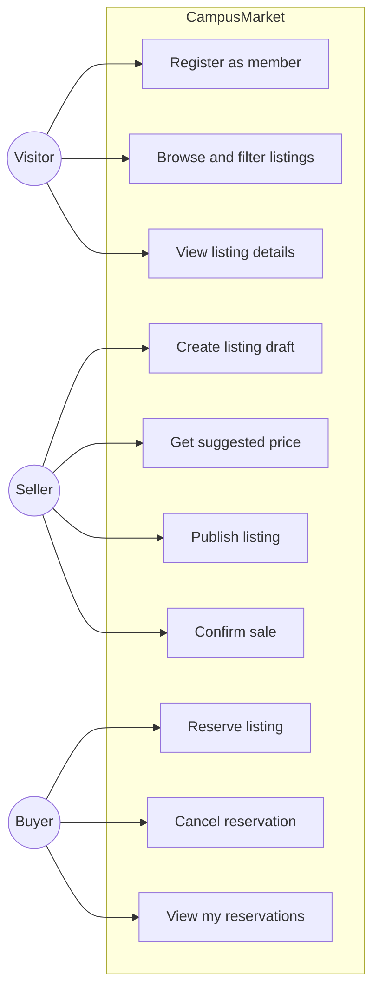
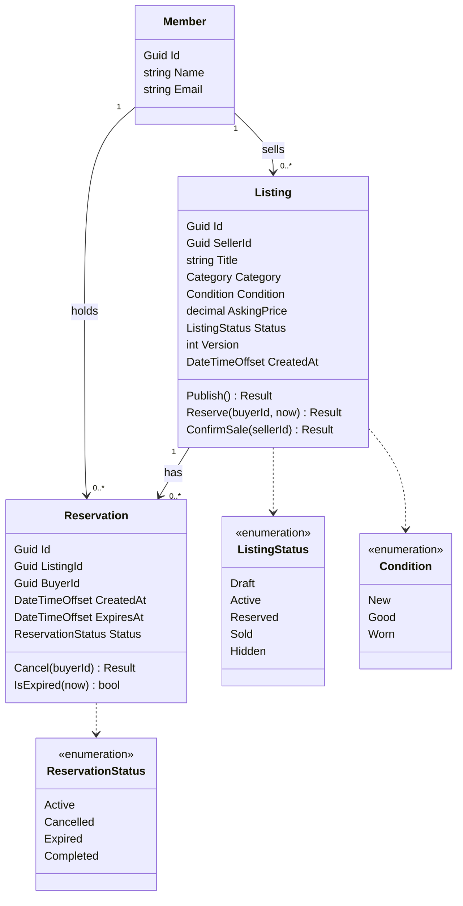
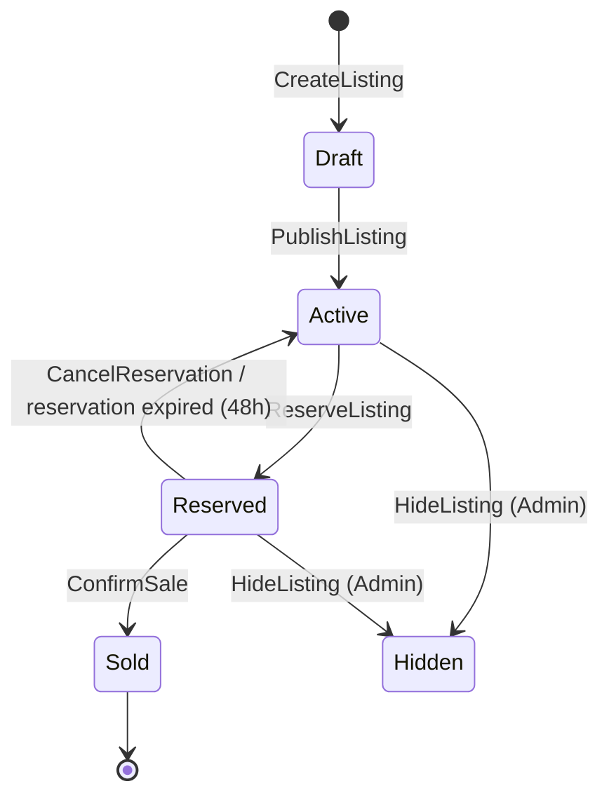
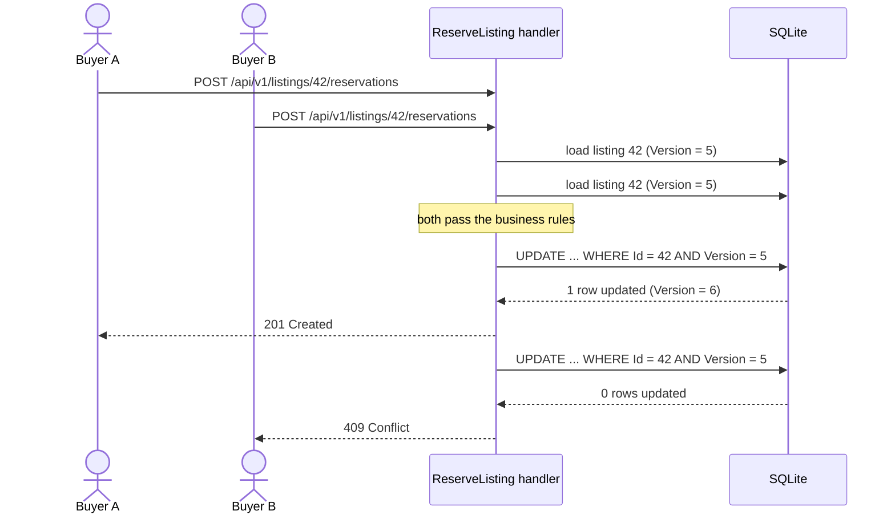

# CampusMarket

A second-hand marketplace for students on campus: textbooks, problem sets, laptops and lab equipment.
Sellers publish listings, buyers reserve them, and an AI module suggests a fair asking price.

## How to run

1. Start the API: open `CampusMarket.sln` and run the **http** profile, or run `dotnet run --project src/CampusMarket.Api --launch-profile http`. It listens on `http://localhost:5112`.
2. In Postman: **Import** (`Ctrl+O`) the file `postman/CampusMarket.postman_collection.json`.
3. Right-click the **CampusMarket** collection → **Run collection** → **Run**. Every request has tests; the `baseUrl` collection variable is `http://localhost:5112` (change it if your port is different).

Unit tests: `dotnet test` from the repository root.

### Web frontend

The web interface is in `frontend/` (React + Vite + TypeScript). It needs Node.js 20 or newer and the API running on `http://localhost:5112`.

```
cd frontend
npm install
npm run dev
```

It opens on `http://localhost:5173`. The API allows only the origins in `Cors:AllowedOrigins` (`appsettings.json`, `http://localhost:5173` by default); for another address set `Cors__AllowedOrigins__0` in the API's environment. To use another API address in the frontend, copy `frontend/.env.example` to `frontend/.env.local` and change `VITE_API_URL`. How the frontend is organised (where to add a page, the API client, login): [frontend/README.md](frontend/README.md).

### With Docker

1. `docker compose up --build` from the repository root. The API listens on `http://localhost:5080` (port 8080 inside the container).
2. Check that it runs: `docker compose ps` shows `healthy`, and `GET http://localhost:5080/health` answers `200 Healthy`.
3. In Postman, set the `baseUrl` collection variable to `http://localhost:5080` and run the collection.

- `docker-compose.yml` sets `ASPNETCORE_ENVIRONMENT=Development`, so the container uses the development JWT key and the seeded Admin from `appsettings.Development.json`. It is a local demo, not a production setup.
- The container runs as the non-root user of the .NET image. The SQLite file is `/app/data/campusmarket.db` inside the container, on the named volume `campusmarket-data`, so the data is kept after `docker compose down`. `docker compose down -v` also removes the volume and starts from an empty database.
- The image has a Docker health check on `/health` (every 30 s). `docker compose ps` shows the container as `healthy` once the API answers and can reach the database, and `unhealthy` after three failed checks.
- The image build fails if one of the trained models (`price-regression.zip`, `category-classification.zip`, `spam-detection.zip`) was not copied to `ml-models/`.
- CI has a `docker` job that builds the image, starts it with `docker compose up --wait` (it waits for `healthy`) and calls `/health`.

### Deploy

The `.github/workflows/deploy.yml` workflow runs on every push to `main`
(and on `workflow_dispatch`): first it restores, builds and runs the full
test suite; then — only if the tests pass — it builds the Docker image from
the repository's `Dockerfile` and pushes it to GitHub Container Registry as
`ghcr.io/<owner>/campus-app` with two tags, `latest` and the full commit
SHA (so a specific build can be pinned if `latest` has to be rolled back).
Login to GHCR uses the built-in `GITHUB_TOKEN`
(`permissions: packages: write, contents: read`); no secret has to be
added for the publish step.

As a final step, if a `RENDER_DEPLOY_HOOK` repository secret is set, the
workflow `curl`s it to trigger a redeploy of the Render service. The step
is skipped when the secret is not set, so the pipeline works end-to-end
before Render is wired up and remains idempotent afterwards.

#### Render (free web service) setup

1. In Render, create a new **Web Service** and choose
   **Deploy an existing image from a registry**. Use the image URL
   `ghcr.io/<owner>/campus-app:latest` (replace `<owner>` with the GitHub
   user or org that hosts the repository). The image is public, so no
   registry credentials are needed. Pin to a specific commit SHA tag if a
   reproducible build matters more than always running `latest`.
2. Set the **Health Check Path** to `/health`. Render polls it to decide
   whether the instance is up; the API returns `200 Healthy` only when it
   can reach the database.
3. Leave the port setting on its default. Render passes the public port
   through the `PORT` environment variable; the API reads it at startup
   (`Program.cs`) and binds to `http://0.0.0.0:$PORT`.
4. Configure the environment variables below under
   **Environment → Environment Variables**. Only names appear here; the
   values are chosen in Render and never committed to the repository.

   | Name | Required | Purpose |
   |---|---|---|
   | `ASPNETCORE_ENVIRONMENT` | yes | Set to `Production`. Triggers the JWT fail-fast check below. |
   | `Jwt__Key` | yes | Random string of **at least 32 characters** used to sign JWTs. The API refuses to start in Production if it is missing or shorter than 32 characters. |
   | `Seed__AdminEmail` | optional | Email of the first Admin created on startup. Leave unset to skip the admin seed. |
   | `Seed__AdminPassword` | optional | Password of the first Admin. Needed only when `Seed__AdminEmail` is set. |
   | `ConnectionStrings__CampusMarket` | optional | SQLite connection string. The Docker image already defaults this to `Data Source=/app/data/campusmarket.db`, so it only needs to be overridden to point the API at a different path (for example, an attached disk). |
   | `Seed__DemoData` | optional | `true` seeds a demo member and a few published listings when the database is empty, so a fresh Render instance has something to browse. Off by default and never on in tests. |
   | `Seed__DemoPassword` | optional | Password for the demo student account created when `Seed__DemoData=true`. Must be at least 8 characters. If missing or shorter, the demo listings are still seeded but the demo member is skipped (a warning is written to the log). The demo member always has the `Student` role. |

5. Set up the deploy hook (optional but recommended). In Render, open
   **Settings → Deploy Hook** on the service, copy the URL, and add it as a
   GitHub repository secret named `RENDER_DEPLOY_HOOK`. Future pushes to
   `main` will then rebuild the image, push it to GHCR, and tell Render to
   pull it.

#### Free-plan limits to know about

- **Sleep after 15 minutes of inactivity.** The first request after a
  sleep wakes the instance; typical cold-start latency is tens of seconds.
  Render's uptime checks keep the service warmer than no traffic at all,
  but there is no hard guarantee it stays up.
- **No persistent disk on the free tier.** SQLite lives inside the
  container's filesystem, which is reset on every redeploy and every
  cold start, so the database is wiped whenever a new image is pulled or
  the instance is rebuilt. Set `Seed__DemoData=true` to repopulate a bit
  of data after each redeploy; attach a disk (paid tier) if the data has
  to survive.
- **One instance, no scaling.** Fine for a student demo, not for traffic.

---

## Table of contents

1. [Team](#1-team)
2. [Project overview](#2-project-overview)
3. [Use cases](#3-use-cases)
4. [Domain model](#4-domain-model)
5. [Key flows](#5-key-flows)
6. [Architecture](#6-architecture)
7. [Work packages](#7-work-packages)
8. [How we work](#8-how-we-work)

---

## 1. Team

| # | Name | GitHub |
|---|------|--------|
| 1 | Matasel Sara Giulia | `@sara-giulia` |
| 2 | Ilenei Ancuta-Bianca | `@Anca110` |
| 3 | Coman Carina | `@Carinacoman` |
| 4 | Preutu-Grigore Diana-Smaranda | `@dianapreutu` |

## 2. Project overview

| | |
|---|---|
| **Domain** | Second-hand marketplace for students |
| **Aggregates** | `Member`, `Listing`, `Reservation` |
| **Business slices** | 9 (see [Use cases](#3-use-cases)) |
| **Hard rule** | Two buyers reserve the same listing at the same moment: one succeeds, the other gets **409 Conflict** from the `Version` check |
| **AI module** | `SuggestPrice`: ML.NET regression that suggests an asking price with a range |

### Business rules

- A listing has a title, category, condition (`New`, `Good`, `Worn`), asking price, an optional description (at most 1000 characters), status (`Draft`, `Active`, `Reserved`, `Sold`) and a `Version` for optimistic concurrency.
- A reservation **expires after 48h** (computed with `TimeProvider`).
- A buyer can hold **at most 3 active reservations**.
- A seller **cannot reserve their own listing**.
- A **sold** listing cannot be reserved.
- The AI price is only a **suggestion**: it is never applied automatically, the seller decides.

### Tech stack

- .NET 10, ASP.NET Core **minimal APIs**
- **Vertical slices** with hand-written **CQRS** handlers (commands and queries)
- **Repository + Unit of Work** over **EF Core** with **SQLite**
- `Result<T>` for expected errors (no exceptions for business rule violations)
- A global exception handler that answers with **ProblemDetails** (see [Error format](#error-format))
- `TimeProvider` for anything that depends on the clock
- **xUnit** with hand-written fakes
- **Postman** collections for API tests
- **SonarQube Cloud** for code quality and coverage, with a quality gate of **100% coverage on new code**
- **ML.NET** (`Microsoft.ML`, `Microsoft.ML.FastTree`, `Microsoft.ML.LightGbm`) for the AI module
- **React + Vite + TypeScript** for the web frontend (`frontend/`), with React Router

## 3. Use cases

### Actors

- **Member**: any registered student. A member acts as a **Seller** when they manage their own listings and as a **Buyer** when they reserve someone else's listing.
- **Visitor**: browses listings without acting on them.



### Use cases mapped to slices

| Use case | Slice | Endpoint (planned) | Rules checked |
|---|---|---|---|
| Register as member | `CreateMember` | `POST /api/v1/members` | unique email |
| Create listing draft | `CreateListing` | `POST /api/v1/listings` | price > 0, valid category and condition |
| Publish listing | `PublishListing` | `POST /api/v1/listings/{id}/publish` | only the owner or an Admin; only from `Draft` |
| Browse and filter listings | `GetListings` | `GET /api/v1/listings?category=&minPrice=&maxPrice=&page=&pageSize=` | only `Active` listings; paging |
| View listing details | `GetListingById` | `GET /api/v1/listings/{id}` | 404 if missing |
| Reserve listing | `ReserveListing` | `POST /api/v1/listings/{id}/reservations` | not own listing; only `Active` (so not sold); max 3 active; **409 on concurrent reservation** (`Concurrency.Conflict`, see [Error format](#error-format)) |
| Cancel reservation | `CancelReservation` | `DELETE /api/v1/listings/{id}/reservations/{reservationId}` | the buyer, the seller or an Admin; only if active |
| Confirm sale | `ConfirmSale` | `POST /api/v1/listings/{id}/confirm-sale` | only the seller; only if `Reserved` |
| View my reservations | `GetMyReservations` | `GET /api/v1/members/me/reservations` | only your own (the member comes from the token); expired reservations shown as expired |
| Get suggested price | `SuggestPrice` (AI) | `POST /api/v1/listings/price-suggestion` | suggestion only, never applied |
| Get suggested category | `SuggestCategory` (AI) | `POST /api/v1/listings/category-suggestion` | suggestion only, the seller still picks the category |
| Report a listing | `ReportListing` | `POST /api/v1/listings/{id}/reports` | not own listing; only `Active` or `Reserved`; at most once per member |
| See reported listings | `GetReportedListings` | `GET /api/v1/moderation/listings` | Admins only; hidden listings left out |
| Hide a listing | `HideListing` | `POST /api/v1/moderation/listings/{id}/hide` | Admins only; only `Active` or `Reserved` |
| Review the seller | `AddReview` | `POST /api/v1/listings/{id}/reviews` | only the buyer; only after the sale is confirmed; rating 1 to 5; once per sale |
| See a member's reviews | `GetMemberReviews` | `GET /api/v1/members/{id}/reviews` | public; newest first, with the average rating |

All endpoints are versioned under `/api/v1/` (see [Design decisions](#design-decisions)).

### Implemented so far

| Resource | Slice | Endpoint | Who may call it | Responses |
|---|---|---|---|---|
| Listing | `CreateListing` | `POST /api/v1/listings` | anyone logged in; the seller is the user in the token | 201 + `Location`, 400, 401, 409 |
| Listing | `GetListingById` | `GET /api/v1/listings/{id}` | everyone | 200, 404 |
| Listing | `GetListings` | `GET /api/v1/listings` | everyone | 200, 400 (see [Searching listings](#searching-listings)) |
| Listing | `UpdateListing` | `PUT /api/v1/listings/{id}` | the seller or an Admin | 204, 400, 401, 403 `Listing.NotOwner`, 404 |
| Listing | `DeleteListing` | `DELETE /api/v1/listings/{id}` | the seller or an Admin | 204, 401, 403 `Listing.NotOwner`, 404 |
| Member | `CreateMember` | `POST /api/v1/members` | Admins only (students use `Register`) | 201 + `Location`, 400, 401, 403, 409 |
| Member | `GetMemberById` | `GET /api/v1/members/{id}` | everyone | 200, 404 |
| Member | `GetMembers` | `GET /api/v1/members` | everyone | 200 |
| Member | `UpdateMember` | `PUT /api/v1/members/{id}` | the member or an Admin | 204, 400, 401, 403 `Member.NotOwner`, 404, 409 |
| Member | `DeleteMember` | `DELETE /api/v1/members/{id}` | the member or an Admin | 204, 401, 403 `Member.NotOwner`, 404 |
| Listing | `PublishListing` | `POST /api/v1/listings/{id}/publish` | the seller or an Admin | 204, 400 `Listing.NotDraft`, 401, 403 `Listing.NotOwner`, 404 |
| Listing | `SuggestPrice` | `POST /api/v1/listings/price-suggestion` | anyone logged in | 200 `{ suggestedPrice }` (whole lei, ≥ 1), 400, 401 |
| Listing | `SuggestCategory` | `POST /api/v1/listings/category-suggestion` | anyone logged in | 200 `{ category, confidence }` (confidence 0–1; `category` is null when the confidence is below 0.7), 400, 401 |
| Report | `ReportListing` | `POST /api/v1/listings/{id}/reports` | anyone logged in; the reporter is the user in the token | 201, 400, 401, 404, 409 `Report.AlreadyExists` |
| Moderation | `GetReportedListings` | `GET /api/v1/moderation/listings?page=&pageSize=` | Admins only | 200, 400, 401, 403 |
| Moderation | `HideListing` | `POST /api/v1/moderation/listings/{id}/hide` | Admins only | 204, 400 `Listing.AlreadyHidden` / `Listing.CannotHide`, 401, 403, 404 |
| Review | `AddReview` | `POST /api/v1/listings/{id}/reviews` | the buyer of the sold listing | 201 + `Location`, 400, 401, 403 `Review.NotBuyer`, 404, 409 `Review.AlreadyExists` |
| Review | `GetMemberReviews` | `GET /api/v1/members/{id}/reviews?page=&pageSize=` | everyone | 200, 400, 404 |
| Reservation | `ReserveListing` | `POST /api/v1/listings/{id}/reservations` | anyone logged in; the buyer is the user in the token | 201 + `Location`, 400, 401, 404 |
| Reservation | `CancelReservation` | `DELETE /api/v1/listings/{id}/reservations/{reservationId}` | the buyer, the seller or an Admin | 204, 400 `Reservation.NotActive`, 401, 403 `Reservation.NotAllowed`, 404 |
| Reservation | `ConfirmSale` | `POST /api/v1/listings/{id}/reservations/{reservationId}/confirm` | the seller or an Admin | 204, 400 `Reservation.NotActive` / `Reservation.Expired` / `Listing.Sold`, 401, 403 `Listing.NotOwner`, 404 |
| Reservation | `GetMyReservations` | `GET /api/v1/members/me/reservations` | anyone logged in; only their own reservations | 200, 401 |
| Auth | `Register` | `POST /api/v1/auth/register` | everyone | 201 + `Location`, 400, 409 |
| Auth | `Login` | `POST /api/v1/auth/login` | everyone, at most 5 attempts per minute per IP | 200, 401, 429 |
| Auth | `Refresh` | `POST /api/v1/auth/refresh` | anyone with a valid refresh token | 200, 401 `Auth.InvalidRefreshToken` |
| Auth | `Logout` | `POST /api/v1/auth/logout` | anyone with a valid refresh token | 204, 401 `Auth.InvalidRefreshToken` |
| Favorite | `AddFavorite` | `POST /api/v1/members/me/favorites/{listingId}` | anyone logged in; the member is the user in the token | 201 + `Location`, 400, 401, 404, 409 |
| Favorite | `RemoveFavorite` | `DELETE /api/v1/members/me/favorites/{listingId}` | anyone logged in; only their own favorites | 204, 401, 404 `Favorite.NotFound` |
| Favorite | `GetMyFavorites` | `GET /api/v1/members/me/favorites?page=&pageSize=` | anyone logged in; only their own favorites | 200, 400, 401 |
| Admin | `GetPriceAccuracy` | `GET /api/v1/admin/ml/price-accuracy` | Admins only | 200 `{ count, mae, mape, perCategory, lastRecords }` (`mae`/`mape` null when `count` is 0), 401, 403 |
| Health | health check | `GET /health` (outside `/api/v1`) | everyone | 200 `Healthy` (plain text) when the API can reach the database, 503 `Unhealthy` when it cannot |

GET endpoints are public (including `GET /api/v1/members/{id}/reviews`), except `GET /api/v1/members/me/reservations`, `GET /api/v1/members/me/favorites`, `GET /api/v1/moderation/listings` and `GET /api/v1/admin/ml/price-accuracy` (the last two Admins only). POST, PUT and DELETE need the token from `POST /api/v1/auth/login` in the `Authorization: Bearer <token>` header: without it the API answers 401. A logged-in user who is not the owner gets 403; an Admin passes every ownership check.

### Searching listings

`GET /api/v1/listings` filters, searches and pages the listings. Every parameter is optional. Only `Active` listings are returned: drafts, reserved and sold listings are hidden.

| Parameter | Meaning | Default |
|---|---|---|
| `category` | `Textbook`, `Notes`, `Electronics`, `LabEquipment` or `Other` | all categories |
| `minPrice` | lowest price, inclusive | no limit |
| `maxPrice` | highest price, inclusive | no limit |
| `search` | text in the title, upper and lower case ignored | no search |
| `page` | page number, from 1 | `1` |
| `pageSize` | listings per page, from 1 to 100 | `20` |

Listings come newest first (`createdAt` descending, then `id`), so the same query always returns the same pages.

Example: `GET /api/v1/listings?category=Textbook&minPrice=10&maxPrice=100&search=oop&page=1&pageSize=20`

```json
{
  "items": [ { "id": "...", "title": "OOP textbook", "category": "Textbook", "price": 40, "...": "..." } ],
  "count": 1,
  "totalCount": 1,
  "page": 1,
  "pageSize": 20
}
```

A single listing (`GET /api/v1/listings/{id}`) also returns `description`:

```json
{
  "id": "...",
  "title": "OOP textbook",
  "category": "Textbook",
  "condition": "Good",
  "price": 40,
  "status": "Active",
  "version": 1,
  "createdAt": "...",
  "description": "Looks almost new, no highlights."
}
```

`count` is the number of listings on this page; `totalCount` is the number of listings that match the filters, on all pages.

| Error | When |
|---|---|
| 400 `Listings.InvalidPage` | `page` is less than 1 |
| 400 `Listings.InvalidPageSize` | `pageSize` is outside 1–100 |
| 400 `Listings.InvalidPriceRange` | `minPrice` is greater than `maxPrice` |
| 400 `Request.Invalid` (ProblemDetails, from ASP.NET Core) | `category` is not one of the values above |

Listings (with their reservations) and members are stored in SQLite through EF Core, behind `IListingRepository` / `IMemberRepository` and `IUnitOfWork`. Endpoints depend only on the handlers. Errors from the handlers are returned as `{ "code", "message", "type" }`; everything else as ProblemDetails (see [Error format](#error-format)).

### Authentication

1. `POST /api/v1/auth/register` with `{ "name", "email", "password", "confirmPassword" }`. The password needs at least 8 characters and `confirmPassword` must be exactly the same. Every new account has the role `Student`.
2. `POST /api/v1/auth/login` with `{ "email", "password" }` returns `{ "token", "expiresAt", "refreshToken" }`. The access token is valid for 15 minutes, the refresh token for 7 days.
3. Send the access token on every protected request: `Authorization: Bearer <token>`.
4. When the access token expires, `POST /api/v1/auth/refresh` with `{ "refreshToken" }` returns a new `{ "token", "expiresAt", "refreshToken" }`, without the password. The old refresh token stops working (rotation), so always keep the new one.
5. `POST /api/v1/auth/logout` with `{ "refreshToken" }` cancels the refresh token (204). After that it can no longer be used.

- Passwords are stored only as a hash, never returned.
- Refresh tokens are long random strings (64 bytes from `RandomNumberGenerator`). Only their SHA-256 hash is stored, so a copy of the database cannot be used to log in. An unknown, expired, already used or cancelled refresh token gets the same 401 `Auth.InvalidRefreshToken`.
- A wrong email and a wrong password get the same 401 `Auth.InvalidCredentials`, so nobody can find out which emails have an account.
- Login allows 5 attempts per minute from the same IP, then 429.
- Roles: `Student` and `Admin`. In the Development environment an Admin account is created at startup from `Seed:AdminEmail` / `Seed:AdminPassword` in `appsettings.Development.json`. The JWT key is also there, for development only.
- CORS: browsers may call the API only from the origins in `Cors:AllowedOrigins` (the web frontend, `http://localhost:5173` in development). Any header and method is allowed, `Location` is readable by the frontend, and no cookies are used: the token always goes in the `Authorization` header. The CORS headers are also on error answers (401, 404, 500), so the frontend can read the error.

### Error codes

| Code | HTTP | When |
|---|---|---|
| `Auth.WeakPassword` | 400 | the password has fewer than 8 characters |
| `Auth.InvalidCredentials` | 401 | wrong email or password (same answer for both) |
| `Auth.PasswordsDoNotMatch` | 400 | `confirmPassword` is not the same as `password` |
| `Auth.InvalidRefreshToken` | 401 | the refresh token is unknown, expired, already used by a refresh, or cancelled by logout |
| `Member.EmailTaken` | 409 | another member already uses the email |
| `Member.NotFound` | 404 | no member with that id, also when the buyer of a reservation does not exist |
| `Member.NotOwner` | 403 | you change or delete a profile that is not yours |
| `Listing.NotFound` | 404 | no listing with that id |
| `Listing.NotOwner` | 403 | you change, delete or publish a listing that is not yours |
| `Listing.NotDraft` | 400 | you publish a listing that is not a draft |
| `Listing.NotActive` | 400 | you reserve a listing that is not `Active` (draft, reserved or sold) |
| `Reservation.OwnListing` | 400 | the seller reserves their own listing |
| `Reservation.LimitReached` | 400 | the buyer already has 3 active reservations |
| `Reservation.NotFound` | 404 | the listing has no reservation with that id |
| `Reservation.NotAllowed` | 403 | you cancel a reservation and you are not the buyer, the seller or an Admin |
| `Reservation.NotActive` | 400 | you cancel or confirm a reservation that is not active |
| `Reservation.Expired` | 400 | you confirm a reservation past its 48-hour expiry |
| `Listing.Sold` | 400 | you change a listing that has already been sold |
| `Money.TooHigh` | 400 | the price is above 100000 lei |
| `Listings.InvalidPage`, `Listings.InvalidPageSize`, `Listings.InvalidPriceRange` | 400 | wrong search parameters (see above) |
| `Favorite.OwnListing` | 400 | the seller adds their own listing to favorites |
| `Favorite.ListingNotAvailable` | 400 | the listing is still a draft, or it was hidden by an Admin |
| `Favorite.AlreadyExists` | 409 | the listing is already in your favorites |
| `Favorite.NotFound` | 404 | you remove a listing that is not in your favorites |
| `Favorites.InvalidPage`, `Favorites.InvalidPageSize` | 400 | wrong paging parameters for `GET /api/v1/members/me/favorites` (same rules as the listing search) |
| `Report.OwnListing` | 400 | the seller reports their own listing |
| `Report.ListingNotAvailable` | 400 | the listing is a draft, sold or hidden |
| `Report.ReasonEmpty`, `Report.ReasonTooLong` | 400 | the reason is empty or longer than 500 characters |
| `Report.AlreadyExists` | 409 | you have already reported this listing |
| `Listing.AlreadyHidden` | 400 | an Admin hides a listing that is already hidden |
| `Listing.CannotHide` | 400 | an Admin hides a draft or a sold listing |
| `Moderation.InvalidPage`, `Moderation.InvalidPageSize` | 400 | wrong paging parameters for `GET /api/v1/moderation/listings` |
| `Review.SaleNotCompleted` | 400 | the listing is not sold yet |
| `Review.NotBuyer` | 403 | you review a sale and you are not its buyer (also the seller) |
| `Review.InvalidRating` | 400 | the rating is not between 1 and 5 |
| `Review.CommentTooLong` | 400 | the comment is longer than 500 characters |
| `Review.AlreadyExists` | 409 | the sale has already been reviewed |
| `Reviews.InvalidPage`, `Reviews.InvalidPageSize` | 400 | wrong paging parameters for `GET /api/v1/members/{id}/reviews` |

Validation errors of the data itself (empty title, price 0, invalid email, short name) are 400 with codes such as `Listing.TitleEmpty`, `Listing.DescriptionTooLong` (more than 1000 characters) or `Member.InvalidName`.

### Error format

Every error body has a `code`. There are two shapes, depending on who answers:

| Who answers | Shape | Examples |
|---|---|---|
| a handler (a business rule, `Result` failure) | `{ "code", "message", "type" }` | all the codes in the table above |
| ASP.NET itself, or an exception nobody caught | ProblemDetails (`Content-Type: application/problem+json`) with `type`, `title`, `status`, `detail`, `instance`, `traceId` and `code` | see below |

| Code | HTTP | When |
|---|---|---|
| `Auth.Unauthorized` | 401 | no token, or the token is invalid or expired |
| `Auth.Forbidden` | 403 | the `Admin` policy refuses the user (`POST /api/v1/members` as a student) |
| `Route.NotFound` | 404 | no endpoint at that URL |
| `Request.MethodNotAllowed` | 405 | the URL exists, but not with that HTTP method |
| `Request.Invalid` | 400 | the request cannot be read (bad JSON, unknown enum value such as `"category": "Banana"`) |
| `Request.TooManyRequests` | 429 | more than 5 login attempts per minute |
| `Concurrency.Conflict` | 409 | someone else saved the same listing at the same moment (`DbUpdateConcurrencyException`, see [Key flows](#5-key-flows)) |
| `Server.Error` | 500 | any other exception; the details go only to the log, never to the client |

```json
{
  "type": "https://tools.ietf.org/html/rfc9110#section-15.5.10",
  "title": "Conflict",
  "status": 409,
  "detail": "The data was changed by another request at the same time. Load it again and retry.",
  "instance": "/api/v1/listings/42/reservations",
  "code": "Concurrency.Conflict",
  "traceId": "00-6f1c...-01"
}
```

The code is in `Infrastructure/ErrorHandling/`: `GlobalExceptionHandler` turns exceptions into ProblemDetails, and `AddCampusMarketErrorHandling` adds `code`, `instance` and `traceId` to every ProblemDetails. In `Program.cs`, `UseExceptionHandler` and `UseStatusCodePages` come before authentication, authorization and rate limiting, so the empty 401/403/429 answers get a body too.

### Example scenario: reserving a listing

1. Ana publishes "Calculus textbook, Good condition, 40 RON".
2. Mihai sees it in the listing search and reserves it. The listing becomes `Reserved`.
3. Mihai has 48 hours to pick it up. If nothing happens, the reservation expires and the listing becomes `Active` again.
4. When they meet, Ana confirms the sale. The listing becomes `Sold` and can no longer be reserved.

### Reservation expiry

A background job sweeps the database periodically and expires every active reservation whose 48 h window is over: the reservation's status becomes `Expired` and the listing goes back to `Active`, so another buyer can reserve it. The sweep is a system job, not a user action; it has no HTTP endpoint.

Two settings under `ReservationExpiry` in `appsettings.json` control the job:

| Setting | Default | Meaning |
|---|---|---|
| `Enabled` | `true` | Register the background service. Integration tests set it to `false` so the job never runs during the other tests. |
| `Interval` | `00:05:00` | How often the sweep runs (any `TimeSpan`). |

### Favorites

A member saves listings to find them again later. The member is always the user in the token, so nobody can see or change someone else's favorites.

- `POST /api/v1/members/me/favorites/{listingId}` saves a listing: 201 with `{ id, listingId, createdAt }`. A listing is saved at most once (409 `Favorite.AlreadyExists`), the seller cannot save their own listing (400 `Favorite.OwnListing`) and a draft cannot be saved (400 `Favorite.ListingNotAvailable`). Active, reserved and sold listings can be saved.
- `DELETE /api/v1/members/me/favorites/{listingId}` removes it: 204, or 404 `Favorite.NotFound`.
- `GET /api/v1/members/me/favorites?page=1&pageSize=20` lists them, newest first, with the same paging rules as the listing search (`page` from 1, `pageSize` from 1 to 100, default 20):

```json
{
  "items": [ { "listingId": "...", "title": "Calculus textbook", "category": "Textbook", "condition": "Good", "price": 40, "status": "Active", "favoritedAt": "2026-11-06T09:15:34+00:00" } ],
  "count": 1,
  "totalCount": 1,
  "page": 1,
  "pageSize": 20
}
```

Favorites are stored in their own table (`Favorites`, migration `AddFavorites`), with a unique index on member + listing and foreign keys to `Members` and `Listings`: when a listing or a member is deleted, their favorites are deleted too.

A listing hidden by an Admin cannot be saved (400 `Favorite.ListingNotAvailable`) and is left out of the list while it is hidden.

### Moderation

Members report listings, the spam model reports suspicious ones on its own, and Admins decide.

- `POST /api/v1/listings/{id}/reports` with `{ "reason": "..." }` (1–500 characters): 201 with `{ id, listingId, createdAt }`. Any logged-in member can report an `Active` or `Reserved` listing of someone else, once (409 `Report.AlreadyExists`).
- When a listing is published, the spam model (see [Machine learning](#machine-learning)) checks its title, description and price. A listing that looks like spam is still published, but gets an **automatic report** (no reporter, with the spam probability).
- `GET /api/v1/moderation/listings?page=1&pageSize=20` (Admins only) lists the reported listings that are not hidden, one row per listing, the most reported first:

```json
{
  "items": [ { "listingId": "...", "title": "BANI RAPIZI, SUNA ACUM!!!", "sellerId": "...", "status": "Active", "reportCount": 2, "flaggedAsSpam": true, "spamProbability": 0.97, "lastReportedAt": "2026-11-06T17:44:04+00:00", "reasons": [ "Asks for money on WhatsApp.", "Flagged automatically as spam." ] } ],
  "count": 1,
  "totalCount": 1,
  "page": 1,
  "pageSize": 20
}
```

- `POST /api/v1/moderation/listings/{id}/hide` (Admins only): 204. The listing becomes `Hidden`: it leaves the search, the moderation list and the favorites lists, and it cannot be reserved, reported or saved. A reserved listing loses its active reservation. Only `Active` and `Reserved` listings can be hidden.

Reports are stored in their own table (`Reports`, migration `AddReports`), with a unique index on listing + reporter and foreign keys to `Listings` and `Members` (cascade delete).

### Seller reviews

After a sale is confirmed, the buyer rates the seller once.

- `POST /api/v1/listings/{id}/reviews` with `{ "rating": 5, "comment": "..." }`: 201 with `{ id, listingId, sellerId, rating, comment, createdAt }` and `Location` to the seller's reviews. Only the buyer of the confirmed sale can do it (403 `Review.NotBuyer` for anyone else, the seller included), only when the listing is `Sold` (400 `Review.SaleNotCompleted`), with a rating from 1 to 5 and an optional comment of at most 500 characters. One review per sale (409 `Review.AlreadyExists`).
- `GET /api/v1/members/{id}/reviews?page=1&pageSize=20` is public and shows the member's reviews as a seller, newest first, with the average of all their ratings (two decimals, `null` when there are none):

```json
{
  "memberId": "...",
  "averageRating": 4.5,
  "reviewCount": 2,
  "items": [ { "id": "...", "listingId": "...", "reviewerId": "...", "rating": 4, "comment": null, "createdAt": "2026-11-06T18:57:06+00:00" } ],
  "count": 1,
  "page": 1,
  "pageSize": 20
}
```

Reviews are stored in their own table (`Reviews`, migration `AddReviews`), with a unique index on the listing (one sale, one review) and foreign keys to `Listings` and to `Members` for the seller and the reviewer (cascade delete).

## 4. Domain model



**Relationships:** a `Member` sells many `Listing`s (**one-to-many**, through `Listing.SellerId`). Members and listings are also connected **many-to-many** through the join entity `Reservation` (`MemberId` + `ListingId`): a member can reserve many listings, and a listing can have many reservations over time. A `Listing` owns its reservations and exposes them only as `IReadOnlyList<Reservation>`. `Favorite` is a second join entity between members and listings (`MemberId` + `ListingId`, at most one per pair). `Report` links a listing to the member who reported it (`ReporterId` is empty for the automatic reports of the spam model). `Review` links a sold listing to its seller and its buyer, with the rating.

**Value objects:** `Money` (amount > 0) and `Email` (normalized to lower case, one `@` with text before and after) are immutable records that can only be created through a factory returning `Result<T>`.

### Listing lifecycle



Any other transition returns an error through `Result<T>` (for example "a sold listing cannot be reserved").

## 5. Key flows

### Hard rule: two buyers reserve the same listing at the same moment

Optimistic concurrency: `Listing.Version` is a concurrency token in EF Core. Both requests read version 5; the first save changes it to 6; the second save finds that the row no longer has version 5, EF Core throws `DbUpdateConcurrencyException`, and the global exception handler (`Infrastructure/ErrorHandling/GlobalExceptionHandler.cs`) turns it into **409 Conflict** with the code `Concurrency.Conflict`.



Two requests rarely meet at exactly the same moment in a test, so the integration test (`ErrorHandling/ErrorHandlingTests.cs`) makes the conflict happen on purpose: a test unit of work changes the row's `Version` right before the save, EF Core throws a real `DbUpdateConcurrencyException`, and the test checks the 409 and that only the other change was saved.


## 6. Architecture

### Planned folder structure

```
CampusMarket.sln
├── src/
│   ├── CampusMarket.Api/
│   │   ├── Features/                 # one folder per slice
│   │   │   ├── Members/CreateMember/
│   │   │   ├── Listings/CreateListing/
│   │   │   ├── Listings/PublishListing/
│   │   │   ├── Listings/GetListings/
│   │   │   ├── Listings/GetListingById/
│   │   │   ├── Reservations/ReserveListing/
│   │   │   ├── Reservations/CancelReservation/
│   │   │   ├── Listings/ConfirmSale/
│   │   │   ├── Reservations/GetMyReservations/
│   │   │   └── Pricing/SuggestPrice/
│   │   ├── Domain/                   # Member, Listing, Reservation, enums
│   │   ├── Infrastructure/           # DbContext, repositories, UnitOfWork
│   │   ├── Common/                   # Result<T>, Error, endpoint helpers
│   │   └── Program.cs
│   └── CampusMarket.Train/           # console tool: train + evaluate the price model
├── tests/
│   ├── CampusMarket.UnitTests/
│   └── CampusMarket.IntegrationTests/
├── data/
│   └── synthetic-sales.csv           # SYNTHETIC training data
├── postman/
│   └── CampusMarket.postman_collection.json
└── README.md
```

Each slice folder contains the request/response records, the handler and the endpoint mapping for that one use case.

### Design decisions

| Decision | Why |
|---|---|
| Vertical slices | Each use case lives in one folder, so team members rarely edit the same files. |
| Repository + Unit of Work | Handlers do not depend on EF Core directly and can be tested with fakes. |
| `Result<T>` | Business rule violations are expected outcomes, not exceptions. The endpoint maps them to HTTP codes. |
| `TimeProvider` | The 48h expiry can be tested by moving a fake clock forward. |
| `Version` concurrency token | Solves the hard rule without locks. |
| API versioning (`/api/v1/`) | All endpoints live in one versioned route group. If a contract ever has to change in a breaking way, we add `/api/v2/` next to it instead of breaking existing clients and Postman tests. |


## 7. Work packages

The project is divided into five work packages.

| Package | Slices and tasks | Tests |
|---|---|---|
| **Shared infrastructure** | Solution setup, `Result<T>`, DbContext, repositories, Unit of Work, `TimeProvider` registration, `/api/v1` route group, error → HTTP mapping | Unit tests for `Result<T>` |
| **Member** | `CreateMember` | Handler tests |
| **Listing** | `CreateListing`, `PublishListing`, `GetListings` (filters + paging), `GetListingById` | Domain rules for `Listing`, query tests |
| **Reservation** | `ReserveListing`, `CancelReservation`, `ConfirmSale`, `GetMyReservations`, 48h expiry, max 3 reservations, concurrency 409 | Rules + fake clock tests, parallel reservation integration test |
| **AI module** | Synthetic CSV generator, `CampusMarket.Train` (train + evaluate + baseline), `IPriceSuggester`, ML.NET and Fake implementations, `SuggestPrice` endpoint | Fake suggester tests, endpoint test |

However the work is split, every slice comes with its tests, its Postman requests and a README update, and every pull request is reviewed by another member.

**Order matters:** the shared infrastructure blocks everything else, so it is done first. The AI module does not depend on the database, so it can be worked on in parallel.


## 8. How we work

### Git workflow

- `main` is always working.
- Each task gets its own branch: `feature/reserve-listing`, `fix/listing-paging`.
- Work is merged through a **pull request** reviewed by at least one other member.
- Small commits with clear messages: `Add 48h expiry to Reservation`.

### Definition of done for a slice

- [ ] Endpoint works and returns the right HTTP codes
- [ ] Business rules return `Result` errors, not exceptions
- [ ] Unit tests for the rules
- [ ] Request(s) added to the Postman collection
- [ ] SonarQube Cloud quality gate passed, with **100% coverage on new code**
- [ ] Reviewed and merged into `main`

### Communication

- Weekly team meeting (after the lab) to check progress and plan the next week.
- Tasks tracked as GitHub Issues, one per slice, assigned to whoever picks it up.
- A team chat group for day-to-day questions.

### Code conventions

- Private instance fields use `_camelCase`: `_reservations`, `_hasher`, `_value`. Decided in week 5, because code review v3 and v5 disagreed on the `_` (`REVIEW.md`, row 14).
- Constructor parameters, including primary constructor parameters (`repository` in `RegisterHandler`), have no `_`.
- `const` and `static readonly` fields use `PascalCase`: `Now`, `CreatedAt`, `InvalidCredentials`.
- When EF Core uses a field by name (`HasField("_reservations")`), rename the string together with the field: a wrong name still builds, but fails at runtime.

## Testing

- **Run the unit tests:** `dotnet test tests/CampusMarket.UnitTests`
- **Run the integration tests:** `dotnet test tests/CampusMarket.IntegrationTests`
- **Generate the coverage report** (run from the repository root, install the tool once with `dotnet tool install -g dotnet-reportgenerator-globaltool`):

  ```
  dotnet test tests/CampusMarket.UnitTests --collect:"XPlat Code Coverage" --settings coverlet.runsettings --results-directory ./TestResults
  ```

  ```
  reportgenerator -reports:"TestResults/**/coverage.opencover.xml" -targetdir:coverage-report -reporttypes:Html -filefilters:"+*Domain*;+*Features*Handler.cs"
  ```

- **Open the report:** open `coverage-report/index.html` in a browser
- **Coverage exclusions:** see the list below, each one with its reason

### Mutation testing

Stryker.NET checks that the unit tests really verify the code: it changes `Domain/` and the handlers on purpose and checks that a test fails each time. **Current mutation score: 100%** (326 mutants killed, 0 survived; 82.13% in week 4).

```
dotnet tool install -g dotnet-stryker
cd tests/CampusMarket.UnitTests
dotnet stryker
```

Details and the two equivalent mutants: [MUTATION.md](MUTATION.md). Report: `mutation-report/mutation-report.html`.

### Coverage exclusions

The coverage report covers only `Domain/` and the handlers (`*Handler.cs`), and the target is 100% for them. Everything else is outside the target:

- `Program.cs`: starts the web host, no logic to test (also excluded in the CI).
- `CampusMarketSetup.cs`: only registers services and routes.
- `Common/CQRS/`: marker interfaces and reflection-based handler registration, checked by the integration tests.
- `Infrastructure/`: EF Core DbContext, configurations, repositories and unit of work, no domain logic, covered by the integration tests.
- `Features/` except `*Handler.cs`: endpoints, requests, responses, commands and queries are HTTP mapping or plain data, covered by the integration tests.
- `ml/**`: dev tools for the AI module (synthetic dataset generator), not app code shipped by the API.
- `frontend/**`: the web frontend (TypeScript), outside the .NET coverage (also excluded in the CI).

SonarCloud measures more than this report: the whole API, merged from all the test projects, is at 100%. It leaves out only `Program.cs`, `ml/**`, `frontend/**` and the EF Core migrations (`**/Migrations/**`), which are generated and whose `Down()` methods never run, because the app only applies migrations.

---

## Machine learning

The AI module (price, category and spam) is trained offline and served by the API.

```
ml/
├── CampusMarket.ML.DatasetGenerator/   # writes the synthetic CSV
├── CampusMarket.ML.Training/           # loads the CSV and trains the models
├── data/
│   ├── catalog/                        # dataset v2 catalog, one JSON per category
│   │   ├── textbook.json
│   │   ├── notes.json
│   │   ├── electronics.json
│   │   ├── labequipment.json
│   │   └── other.json
│   └── listings.csv                    # synthetic dataset, generated
└── models/
    └── *.zip                           # trained models, committed
```

Flow: **catalog → dataset → training → models → API**. The catalog is the
source of truth for item types, prices and natural Romanian titles and
descriptions; the generator reads it and layers on realistic noise; the
training project reads the CSV, runs a 70 / 15 / 15 train / validation / test
split and writes the trained models into `ml/models/`. The `.csproj` of the
API copies every `ml/models/*.zip` to its output under `ml-models/`, so the
API runs without training.

The split is **group-aware by `TemplateId`** (`DatasetSplit`, seed `2026`): both
`TrainTestSplit` cuts pass `samplingKeyColumnName = TemplateId`, so every row
of an item type lands in exactly one of train / validation / test and the
quality tests therefore evaluate on item types the model has never seen. Pure
spam rows are grouped by their spam pattern (one `TemplateId` per spam
description body, e.g. `spam-00` … `spam-11`), so the test set holds spam
patterns the model has never seen. On top of that, `PriceTrainer` runs a
**5-fold grouped cross-validation** on train + validation (test held out,
same non-spam filter as the price evaluation) and reports R², MAE and RMSE as
mean ± std — a tighter check of how well the model generalizes than a single
hold-out split.

### Baselines

After training, the program prints a side-by-side table comparing each model
against trivial baselines on the same test part (`DatasetSplit`, grouped by
`TemplateId`). The model must beat the baselines on every metric; if it does
not, it is not learning anything the baselines miss.

Baselines (`ml/CampusMarket.ML.Training/Evaluation/Baselines.cs`):

- **Price** (non-spam rows): predicts the mean price of the same
  `Category × Condition` from the train part, falling back to the category
  mean and then the global mean.
- **Category** (non-spam rows):
  - (a) always the most frequent class of the train part;
  - (b) a short Romanian keyword rule
    (`carte`/`manual`/`curs` → Textbook, `notite`/`rezumat` → Notes,
    `laptop`/`telefon`/`casti` → Electronics,
    `microscop`/`halat`/`pipeta` → LabEquipment, else Other).
- **Spam** (all rows): the description or title contains a phone number, a
  link, `whatsapp`/`telegram`, three or more exclamation marks, or the price
  is `<= 5` lei.

Last run (seed `2026`, 15% grouped test part):

Price (non-spam, test):

| Metric | Model (FastTree on log1p(Price), picked by MAE on validation) | Baseline (mean by Category × Condition) |
|---|---|---|
| R² | **0.451** | 0.274 |
| MAE | **268.53** lei | 345.44 lei |
| RMSE | **606.21** lei | 697.05 lei |
| MAPE | **75.3%** | 179.6% |

Details of the 6-candidate selection, the per-category MAE and the
5-fold grouped CV are in [docs/ml/price.md](docs/ml/price.md).

Category (non-spam, test):

| Metric | Model (SDCA max entropy) | Most frequent class | Keyword rule |
|---|---|---|---|
| Micro accuracy | **0.853** | 0.281 | 0.519 |
| Macro accuracy | **0.858** | 0.200 | 0.484 |

Spam (all rows, test):

| Metric | Model (SDCA logistic) | Rule baseline |
|---|---|---|
| Accuracy | **1.000** | 0.987 |
| Precision | **1.000** | 0.667 |
| Recall | 1.000 | 1.000 |
| F1 score | **1.000** | 0.800 |

### External evaluation

`ml/data/external.csv` is an out-of-catalog sanity check: an AI was asked
to draft 125 second-hand student listings without access to our catalog or
`listings.csv`, then the team rewrote the first 30 rows after real
listings we have seen (titles and phrasing we did not generate) and kept
the rest as review-light drafts. Columns match `listings.csv` exactly
(`Title,Description,Category,Condition,Price,IsSpam,TemplateId`, all with
`TemplateId = external`), and the file carries no personal data — no
names, phone numbers, email addresses or links to real sellers. 122 rows
load as data (the last 3 lines are blank), of which 102 are non-spam and
20 are spam, roughly balanced across the five categories (Electronics 27,
LabEquipment 23, Notes 24, Other 25, Textbook 23). After training, the
program loads the saved `.zip` models — the same files the API serves —
and scores them on these rows next to the baselines from `Baselines.cs`.

Last run (seed `2026`):

| Task | Metric | Test (model) | Test (baseline) | External (model) | External (baseline) |
|---|---|---|---|---|---|
| Price (non-spam) | R² | **0.451** | 0.274 | **0.511** | 0.011 |
| Price (non-spam) | MAE (lei) | **268.53** | 345.44 | **112.10** | 192.05 |
| Price (non-spam) | MAPE | **75.3%** | 176.5% | **55.1%** | 132.1% |
| Category (non-spam) | Micro accuracy | **0.853** | 0.281 | **0.735** | 0.196 |
| Category (non-spam) | Macro accuracy | **0.857** | 0.200 | **0.737** | 0.200 |
| Spam (all) | Accuracy | **1.000** | 0.987 | 0.918 | 0.934 |
| Spam (all) | Precision | **1.000** | 0.667 | 1.000 | 0.929 |
| Spam (all) | Recall | 1.000 | 1.000 | 0.500 | 0.650 |
| Spam (all) | F1 score | **1.000** | 0.800 | 0.667 | 0.765 |

The price and category models still beat their baselines on external
data, and by a larger R² margin than on the test part — the external
prices are more concentrated around the catalog averages, so the baseline
collapses while the model generalizes. Spam is the honest miss: the test
part is saturated because synthetic spam signals the generator plants
(links, phone numbers, `!!!`, 1-leu prices) are the same the rule
baseline catches, so both reach 1.000. The external set has ten subtle
spam rows with normal titles, normal prices and no scam keywords
(`"Laptop gaming i7 ieftin"`, `"Notite drept civil"`, `"Bilet festival
Untold"`), which neither the model nor the rule catch — recall drops to
0.500 for the model and 0.650 for the rule. That gap is a dataset-v2
limit and a task for the next iteration of the spam generator, not a
regression in the committed model.

### Dataset v2

- **Seed:** `const int Seed = 2026` in both the generator and the trainer, so
  every run produces identical bytes.
- **Catalog:** 5 JSON files in `ml/data/catalog/` (over 300 item types total,
  covering textbooks per subject and year, notes, laptops, phones, headphones,
  PC parts, small appliances, dorm furniture, clothes, shoes, bikes, scooters,
  lab equipment, musical instruments, sports gear, games, kitchen items,
  decorations, tickets and more). Every item has **8+ natural titles** and
  **8+ descriptions** in Romanian, a realistic price range in lei and typical
  conditions. Items are mapped to one of the five `Category` values
  (`Textbook`, `Notes`, `Electronics`, `LabEquipment`, `Other`).
- **Variation at generate time:** the seeded `Random` strips diacritics in
  about 55% of rows, introduces an occasional swap-letter typo, abbreviates
  words the student way (`vand`, `neg.`, `pt`, `stare f buna`, `sem`, `ed.`,
  `vol.`), randomizes capitalization or shouts the whole title in ALL CAPS,
  sometimes attaches an emoji, drops the description in ~12% of rows,
  stretches it to a long paragraph in ~8%, and perturbs the price ±20%.
- **Label noise:** on purpose, about **3% of non-spam rows carry the wrong
  category** (a seller who picked the wrong dropdown).
- **Spam:** 10% of rows. About one third of the spam is **disguised** — a
  normal-looking title in a legitimate category, with the scam/contact hint
  only in the description — and the rest is loud ALL-CAPS spam with absurd
  prices (1 leu or 50000–100000 lei). About 6% of normal listings contain a
  single spam-adjacent word (`urgent`, `promotie`, `rapid`, …) without being
  spam, so the classifier has to look at the whole context.
- **CSV columns:** `Title,Description,Category,Condition,Price,IsSpam,TemplateId`.
  `TemplateId` is the item-type id from the catalog (`tb-analiza-mate-y1`,
  `elec-laptop-thinkpad`, …) or `spam-generic` for the loud spam rows; it is
  the **last** column so the existing `ListingRow` column indexes 0–5 do not
  shift.

### Regenerate the dataset and retrain

From the repository root:

```
dotnet run --project ml/CampusMarket.ML.DatasetGenerator
dotnet run --project ml/CampusMarket.ML.Training
```

The first command rewrites `ml/data/listings.csv` (seed `2026`) and prints the
row count, the number of item types per category, the rows per `Category` and
`Condition`, the spam percentage, the min / avg / max price per `Category`,
and 10 sample rows. Two runs produce identical bytes; compare the printed
SHA256 hashes to check. The second command trains the three models with
seed `2026` and writes them to `ml/models/`. The `PredictionEnginePool`
registrations live in `src/CampusMarket.Api/Infrastructure/ML/`.

### Reproducibility

Everything in the pipeline is pinned so two runs produce the same bytes:

- **Seed `2026`** lives in `DatasetSplit.Seed` and in the generator (same
  constant in both). The `MLContext` is built with this seed.
- Every ML.NET trainer passes **`NumberOfThreads = 1`** in its Options object
  (`PriceTrainer`, `CategoryTrainer`, `SpamTrainer`). SDCA, FastTree and
  LightGBM only produce identical metrics across runs when they do not
  parallelize over threads.
- Beside each saved model, the trainer writes a **`<model-file>.json`
  sidecar** (`ModelMetadata.cs`): the model name, the chosen algorithm and
  target, UTC timestamp (ISO 8601), seed, split (70/15/15 grouped by
  `TemplateId`), SHA-256 of `ml/data/listings.csv`, row counts per part, the
  test metrics as numbers, and the git commit from `GITHUB_SHA` if set. Keys
  are sorted alphabetically and metrics are written with six decimals, so a
  `git diff` of two runs only highlights real changes.
- CI (`.github/workflows/ml.yml`, runs on `ml/**` or
  `tests/CampusMarket.ML.Tests/**` changes): sets up .NET 10, restores, then
  (1) regenerates `ml/data/listings.csv` with the generator and fails if
  `git diff --exit-code` reports a byte change; (2) trains the models;
  (3) runs `ml/scripts/check_metrics.py` on the new sidecars against the
  committed ones and fails if any R², accuracy or F1 dropped by more than
  0.02 absolute, or MAE grew by more than 5% relative; (4) runs
  `dotnet test tests/CampusMarket.ML.Tests` against the fresh models; and
  (5) uploads `ml/models/*.{zip,json}` as a build artifact. CI never
  commits, pushes or needs secrets.

Reproduce locally in three commands from the repository root:

```
dotnet run --project ml/CampusMarket.ML.DatasetGenerator
dotnet run --project ml/CampusMarket.ML.Training
dotnet test tests/CampusMarket.ML.Tests
```

Running the first two twice in a row produces identical bytes in
`ml/data/listings.csv` and identical `testMetrics` in every
`ml/models/*.json` (only the `trainedAt` timestamp changes).

### Price suggestion model (B3)

- Trainer: `PriceTrainer` in `ml/CampusMarket.ML.Training`, regression on the
  non-spam rows only. Features: `Category` and `Condition` one-hot encoded,
  `Title` and `Description` through `FeaturizeText`.
- **Model selection (price v2):** six candidates — three algorithms (`FastTree`,
  `LightGbm`, `Sdca`) × two targets (`Price`, `log1p(Price)`) — are trained on
  the train part and scored on the **validation** part only; the winner is
  picked by MAE in lei, tie-broken by R². The winner is retrained on
  train + validation and evaluated **once** on the test part (the saved
  model). The current winner is **FastTree on `log1p(Price)`**: dampening the
  heavy-tailed price distribution with `log1p` wins on MAE and MAPE even
  when raw-target Sdca has a higher R². When the target is log-based, the
  saved pipeline appends an `Expression` transform that maps `Score` back
  to lei, so the API's `PriceSuggester` reads `Score` directly and does not
  need to know which target won.
- Test metrics on the 15% grouped hold-out (seed 2026, non-spam, unseen
  `TemplateId`s):

  | Metric | Value |
  |---|---|
  | R²   | **0.451** |
  | MAE  | 268.53 lei |
  | RMSE | 606.21 lei |
  | MAPE | 75.3% |

  5-fold grouped CV on train + validation: R² 0.449 ± 0.106,
  MAE 164.95 ± 42.43 lei, RMSE 383.08 ± 113.76 lei. The six-candidate table,
  the MAE per category and the "when not to trust the suggestion" notes are
  in [docs/ml/price.md](docs/ml/price.md).
- The saved model (`ml/models/price-regression.zip`) is loaded by the API through
  `PredictionEnginePool<PriceInput, PricePrediction>`; the `SuggestPrice` slice
  depends on `IPriceSuggester` (in `Common/Pricing/`) and never sees `Microsoft.ML`.
- Quality gate: the `CampusMarket.ML.Tests` project reloads the committed model
  on the shared grouped split and fails if R² on the test part drops below
  **0.40** (winner's test R² − 0.05, rounded down to two decimals — see
  `MinRSquared` and [docs/ml/price.md](docs/ml/price.md)), or if, for the
  same title, `Condition = New` is not priced higher than `Condition = Worn`.

#### Price feedback loop

Training metrics measure the model against a synthetic test split; the real
check is against sales people actually made. Every time a seller confirms a
sale (`POST /api/v1/listings/{id}/reservations/{reservationId}/confirm`),
`ConfirmSaleHandler` asks the same `IPriceSuggester` the `SuggestPrice`
slice uses what it would have suggested for that listing (title,
description, category, condition), and writes a `SaleRecord` in the same
`CommitAsync` as the sale: `ListingId`, `Category`, `Condition`, the
suggested price, the actual sold price (`Listing.Price.Amount`) and
`SoldAt`. If the suggester throws or returns nothing, the sale still goes
through — a warning is logged and no `SaleRecord` is written, so the
feedback loop never blocks the sale. Records live in the `SaleRecords`
table (migration `AddSaleRecords`), with no FK to `Listings` on purpose so
analytics survives listing deletion.

`GET /api/v1/admin/ml/price-accuracy` (Admins only) reads the table and
returns `count`, overall MAE in lei and MAPE in %, the same metrics broken
down per `Category`, and the 10 newest records (`listingId`, `category`,
`condition`, `suggestedPrice`, `soldPrice`, `soldAt`). On an empty table
the response is `{ count: 0, mae: null, mape: null, perCategory: [],
lastRecords: [] }`. The query handler uses `AsNoTracking` reads through
`ISaleRecordRepository` and no `IUnitOfWork`.

### Category suggestion model (B4)

- Trainer: `CategoryTrainer` in `ml/CampusMarket.ML.Training`, multiclass
  classification with SDCA maximum entropy on the non-spam rows only. Features:
  `Title` and `Description` through `FeaturizeText`, concatenated. Label: `Category`.
- Metrics on the 15% hold-out (seed 2026, non-spam rows):

  | Metric | Value |
  |---|---|
  | Micro accuracy | **0.935** |
  | Macro accuracy | 0.928 |
  | Log loss | 0.294 |

  The accuracy is no longer saturated: dataset v2 adds label noise, overlapping
  vocabulary across categories and seller-style noise, so the model has to work
  for every point.
- The saved model (`ml/models/category-classification.zip`) is loaded by the API
  through `PredictionEnginePool<CategoryInput, CategoryPrediction>`; the
  `SuggestCategory` slice depends on `ICategorySuggester` (in `Common/Categories/`).
  The confidence is the highest class probability, rounded to two decimals.
- There is no category for items like clothes, so the model always picks the
  closest of the five; it is only a suggestion and the seller can change it.
- Quality gate: the `CampusMarket.ML.Tests` project reloads the committed model
  on its own split (seed 42, 20%) and fails if the micro accuracy drops below
  0.9, or if three listings written by hand (not in the CSV) get the wrong
  category.

### Spam detection model (B5)

- Trainer: `SpamTrainer` in `ml/CampusMarket.ML.Training`, binary classification
  with SDCA logistic regression on all rows. Features: `Title` and `Description`
  through `FeaturizeText`, and `Price` split into bins (spam often has absurd prices,
  1 leu or tens of thousands). Label: `IsSpam`.
- Metrics on the 15% hold-out (seed 2026, all rows):

  | Metric | Value |
  |---|---|
  | Accuracy | **1.000** |
  | AUC | 1.000 |
  | F1 score | 1.000 |

  Dataset v2 keeps spam distinctive enough (link-in-bio, WhatsApp, "castiga
  500 lei") that the classifier still separates it cleanly from normal listings,
  even with a third of spam disguised and a few normal listings carrying a
  single spam-adjacent word.
- The saved model (`ml/models/spam-detection.zip`) is loaded by the API through
  `PredictionEnginePool<SpamInput, SpamPrediction>`; `PublishListing` depends on
  `ISpamDetector` (in `Common/Moderation/`) and adds an automatic report when the
  model says spam (see [Moderation](#moderation)).
- Quality gate: the `CampusMarket.ML.Tests` project reloads the committed model
  on its own split (seed 42, 20%) and fails if the AUC drops below 0.95 or the
  F1 score below 0.9, or if four listings written by hand (two spam, two normal)
  are classified wrongly.

---