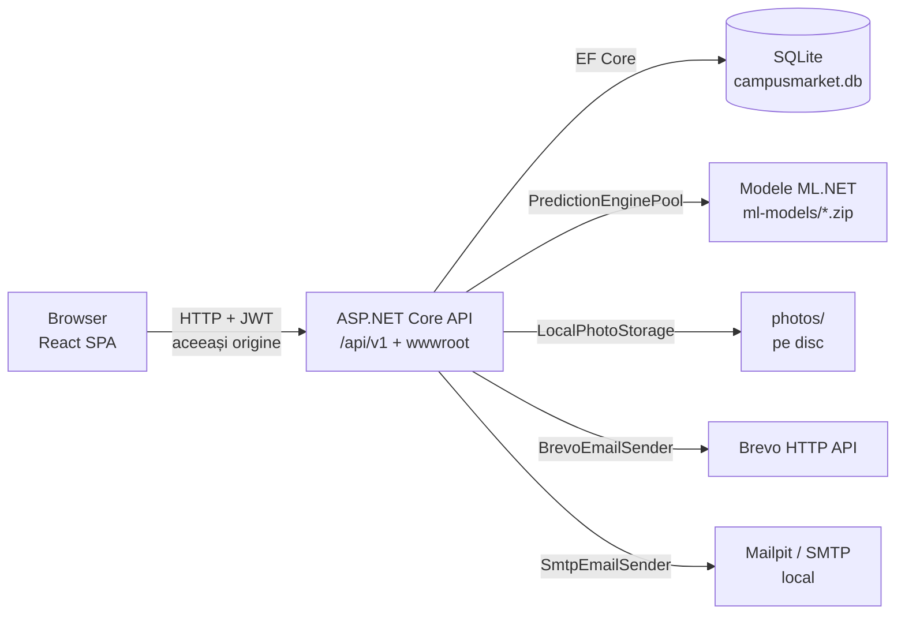
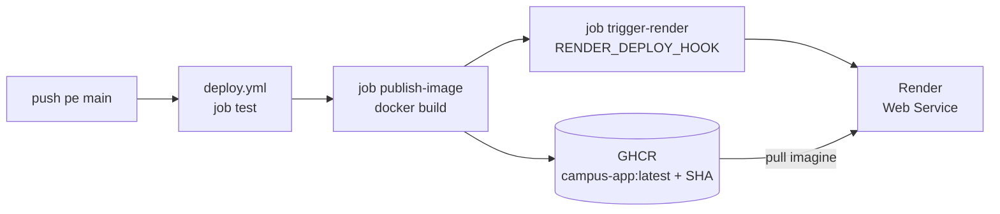
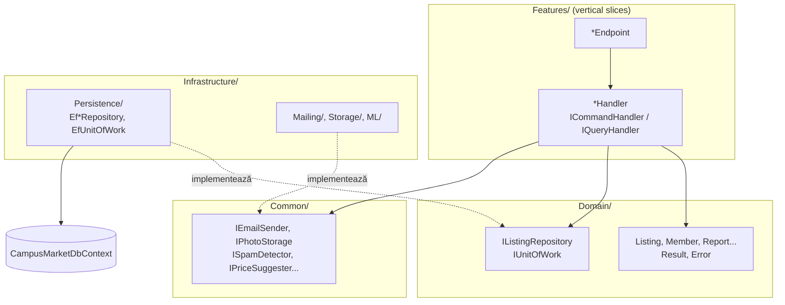
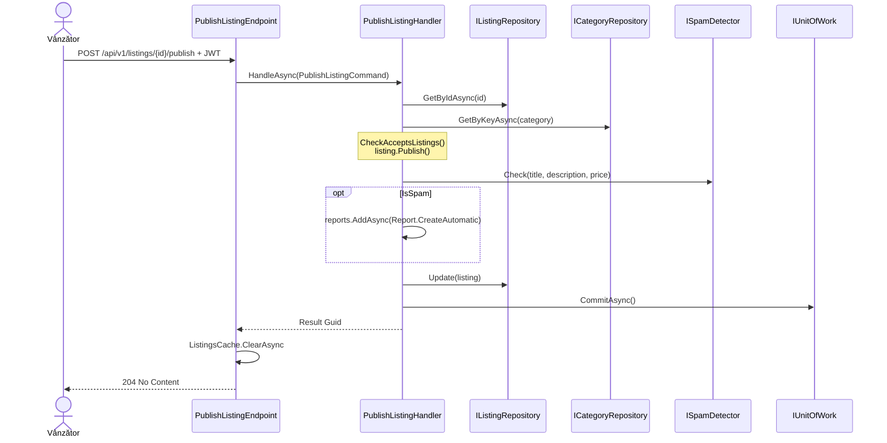
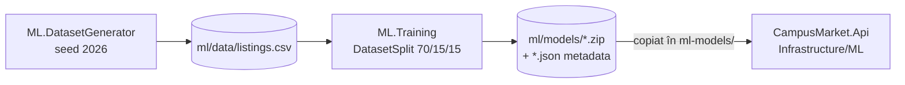
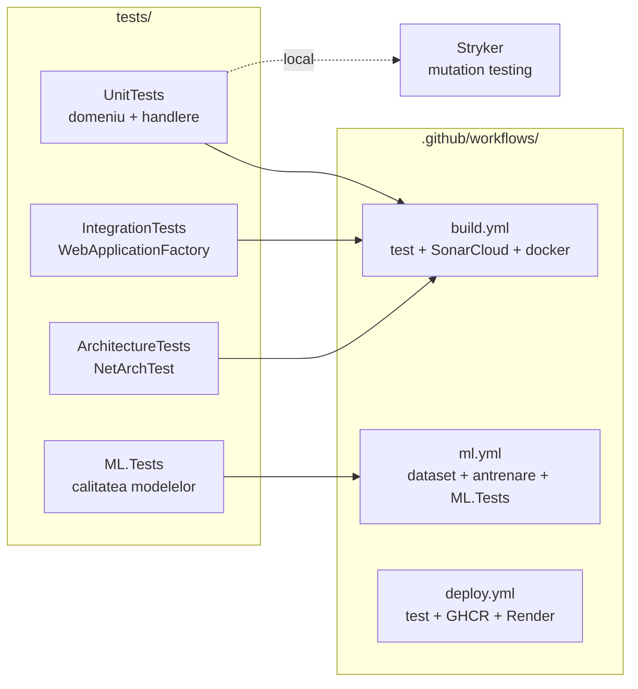

# Arhitectura CampusMarket

Diagramele de mai jos sunt desenate după codul din repository (`src/`, `ml/`, `tests/`, `.github/workflows/`).
Detalii despre fiecare funcționalitate sunt în [README.md](../README.md).

## 1. Privire de ansamblu

- Frontend-ul React (Vite) este construit în `Dockerfile` și copiat în `wwwroot/`; API-ul îl servește cu `UseStaticFiles` și `MapFallbackToFile("index.html")`, deci browserul vorbește cu API-ul pe aceeași origine. În dezvoltare, Vite rulează separat pe `:5173` și API-ul permite CORS doar pentru originile din `Cors:AllowedOrigins`.
- Datele sunt într-un fișier SQLite, accesat prin `CampusMarketDbContext` (EF Core).
- Cele 4 modele (`price-regression`, `category-classification`, `spam-detection`, `similar-listings`) sunt încărcate din `ml-models/` la pornire.
- Email: `BrevoEmailSender` când există `Email__ApiKey` (Render), `SmtpEmailSender` când este setat `Email:Host` (Mailpit în `docker-compose.yml`), altfel `LoggingEmailSender` (doar scrie în log).

### Deploy

Imaginea se construiește doar dacă trec testele. Render rulează imaginea din GHCR, citește portul din `PORT` și verifică `/health`. Pasul `trigger-render` este sărit dacă secretul `RENDER_DEPLOY_HOOK` nu există.

## 2. În interiorul API-ului

- **Features/**: un folder pe caz de utilizare (ex. `Features/Listings/PublishListing/`) cu `Endpoint`, `Command`/`Query`, `Handler`, `Request`/`Response`. Handler-ele sunt scrise de mână (fără MediatR) și întorc `Result<T>`.
- **Domain/**: entitățile și regulile (`Listing.Publish()`, `Listing.Create(...)`), plus interfețele de repository și `IUnitOfWork`.
- **Common/**: interfețe pentru servicii externe (`Auth/`, `CQRS/`, `Email/`, `Storage/`, `Moderation/`, `Pricing/`, `Categories/`, `Similarity/`).
- **Infrastructure/**: implementările (`Persistence/`, `Mailing/`, `Storage/`, `ML/`, `Auth/`, `Background/`, `ErrorHandling/`, `Logging/`). Totul se leagă în `CampusMarketSetup.cs`.
- Regulile de dependență (de ex. `Domain/` nu depinde de `Infrastructure/`) sunt verificate de testele de arhitectură.

## 3. Fluxul unei cereri: publicarea unui anunț

Un anunț se creează ca draft cu `POST /api/v1/listings` (`CreateListingHandler`) și devine public cu `POST /api/v1/listings/{id}/publish`. Verificarea de spam se face la publicare:

- Erori: `404` (anunț inexistent), `403` (nu e vânzătorul sau Admin), `400` (categorie dezactivată, anunțul nu e draft).
- Un anunț suspect rămâne publicat, dar primește un raport automat, vizibil în lista de moderare.
- `SpamDetector` combină probabilitatea modelului (prag `Ml:Spam:Threshold`) cu `SpamRules` (link, telefon, contact în afara aplicației).

## 4. Partea de ML

- `CampusMarket.ML.DatasetGenerator` generează setul de date reproductibil; `CampusMarket.ML.Training` îl împarte 70/15/15 pe `TemplateId` și rulează `PriceTrainer`, `CategoryTrainer`, `SpamTrainer`, `SimilarTrainer`. Fiecare model se salvează ca `.zip`, cu metrici în `.json` alături.
- `CampusMarket.Api.csproj` copiază modelele în `ml-models/`, iar `Dockerfile` oprește build-ul dacă lipsește vreunul.

Cum folosește API-ul modelele:

| Model | Clasa din `Infrastructure/ML` | Unde se folosește |
|---|---|---|
| `price-regression.zip` | `PriceSuggester` | `POST /api/v1/listings/price-suggestion`, plus `ConfirmSaleHandler` (prețul sugerat salvat la vânzare) |
| `category-classification.zip` | `CategorySuggester` | `POST /api/v1/listings/category-suggestion` |
| `spam-detection.zip` | `SpamDetector` | `PublishListingHandler` |
| `similar-listings.zip` | `SimilarListingsFinder` | `GET /api/v1/listings/{id}/similar` |

Documentație ML: secțiunea [Machine learning](../README.md#machine-learning) din README și fișierele din [docs/ml/](ml/) ([preț](ml/price.md), [categorie](ml/category.md), [spam](ml/spam.md), [similare](ml/similar.md)).

## 5. Teste și calitate

- **UnitTests**: domeniul și handler-ele, cu fake-uri scrise de mână (`Fakes/`).
- **IntegrationTests**: cereri HTTP reale prin `WebApplicationFactory<Program>`, pe SQLite în memorie.
- **ArchitectureTests**: regulile de dependență dintre `Domain`, `Features`, `Infrastructure` și handlere.
- **ML.Tests**: pragurile de calitate ale modelelor, pe aceeași împărțire 70/15/15.
- **Stryker**: rulat local pe `UnitTests` (`stryker-config.json`), rezultate în [MUTATION.md](../MUTATION.md); nu este în CI.
- **build.yml** (push pe `main` și pull request): build, `dotnet test` cu acoperire, analiză SonarCloud și jobul `docker` care pornește `docker compose` și verifică `/health`.
- **ml.yml** (push pe `main` și pull request): regenerează setul de date și eșuează dacă `listings.csv` s-a schimbat, antrenează modelele, compară metricile (`ml/scripts/check_metrics.py`) și rulează `ML.Tests`.
- **deploy.yml** (push pe `main`): vezi secțiunea Deploy.
